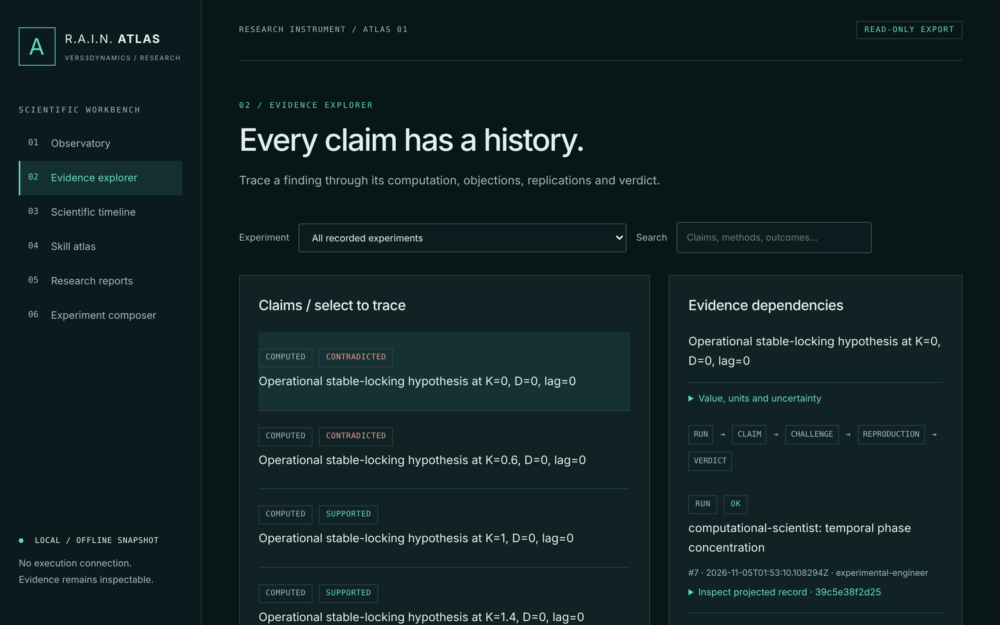
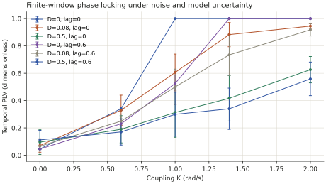

# R.A.I.N. ATLAS

**Scientific work you can inspect, challenge, and reproduce.**

R.A.I.N. ATLAS is the open, local-first scientific workbench from
**Vers3Dynamics**. It runs numerical experiments through versioned skills,
records their evidence, and assigns separate research roles to analysis,
skepticism, and reproduction. Findings retain the calculations and challenges
behind them, including failures and unresolved results.

**v0.1 (unreleased) · 22 executable skills · Offline observatory · MIT license**

[Quick start](#quick-start) · [Recorded results](#recorded-results) ·
[Scientific skills](#scientific-skills) · [Evidence rules](#evidence-rules) ·
[Contributing](#contributing)



*The actual offline observatory, displaying the recorded synchronization study.*
Explore experiments, evidence dependencies, timelines, skills, reports, and a
proposal composer in one standalone HTML file. After cloning, open
[`docs/demonstration/index.html`](docs/demonstration/index.html) in your browser
to inspect the existing study without installing Python dependencies. GitHub's
file view displays the source; open the local file for the interactive viewer.

## Quick start

Install **Git** and **[uv](https://docs.astral.sh/uv/getting-started/installation/)**.
Use a source checkout: it supplies the built-in skill catalog. The commands
below select Python 3.12; Python 3.11 is also supported. Setup downloads the
required dependencies. The experiments then run locally on CPU, with no API
key, model, GPU, or cloud account required.

```sh
git clone https://github.com/topherchris420/rain-atlas.git
cd rain-atlas
uv sync --locked --python 3.12

uv run atlas experiment run synchronization --root atlas-data/sync-001 --replicates 12
uv run atlas ledger verify atlas-data/sync-001/ledger
```

Open **`atlas-data/sync-001/observatory/index.html`** directly in your browser.
No web server or Node.js installation is needed to use the viewer.

| Output under `atlas-data/sync-001/` | What to inspect |
|---|---|
| `observatory/index.html` | Select a claim and trace its evidence, challenges, and verdict |
| `reports/report.md` and `reports/summary.json` | All 30 conditions, acceptance checks, and limitations |
| `reports/synchronization-transition.png` and `.svg` | Figures generated from the recorded results |
| `ledger/` | Original records, referenced artifacts, and source snapshots |

Use a **new `--root` directory** for each experiment; the command refuses an
existing ledger. Automatic resume is not implemented. The
[end-to-end tutorial](docs/TUTORIAL.md) covers search, proposals, approval,
exports, and recovery.

## How a finding is checked

ATLAS records the question, hypothesis, controls, thresholds, and budget before
running the experiment. Its built-in research roles are **scripted policies**;
no language model participates in the supplied demonstrations.

| Role | Responsibility |
|---|---|
| Principal investigator | Preregister the design, select skills by capability, and assemble the report |
| Computational scientist | Run the primary analysis and attach claims to recorded computations |
| Scientific skeptic | Challenge findings with a different method and independent replicate data |
| Experimental engineer | Enforce execution policy and budgets, record provenance, and reproduce runs |

Verdicts are computed from the recorded checks: **supported**, **contradicted**,
or **unresolved**. Reproduction alone is insufficient for support; the
independent checks must corroborate the finding. Missing or inconclusive
evidence stays visible. A supported verdict applies to the stated model,
thresholds, and experiment.

## Recorded results

### Synchronization under noise and uncertainty

The quick-start experiment asks whether two simulated oscillators remain
phase-locked as coupling, noise, and phase lag change. It compares temporal
phase locking with relative-frequency drift, separately seeded replication,
and an analytical reference for deterministic cases away from the threshold.



*Means across independent trajectories, with approximate simultaneous Student-t
intervals and Bonferroni correction across conditions and two metric families.*

The checked-in study uses **30 conditions**, with **12 trajectories per
condition** and a separate 12-trajectory replication ensemble. It records
**5 supported, 10 unresolved, and 15 contradicted** operational locking claims.
All five preregistered acceptance checks passed, including exact reproduction,
evidence verification, and retention of negative outcomes.

These are finite-window results for a synthetic two-oscillator model. Physical
validation and an infinite-population transition are outside this experiment.

[Read the report](docs/demonstration/report.md) ·
[Inspect the results](docs/demonstration/summary.json) ·
[Check provenance](docs/demonstration/README.md) ·
[Numerical assumptions](docs/RESONANCE.md)

### Recovering frequencies from noisy signals

The spectral reference experiment tests whether separate methods can recover
and validate three tones as noise increases, with a noise-only control.

```sh
uv run atlas experiment run spectral-recovery --root atlas-data/spectral-001
uv run atlas ledger verify atlas-data/spectral-001/ledger
uv run atlas observatory export atlas-data/spectral-001/ledger --out atlas-data/spectral-view
```

Open `atlas-data/spectral-view/index.html`. The experiment produces Markdown
and JSON reports, PNG/SVG figures, and a ZIP reproducibility bundle under
`atlas-data/spectral-001/reports/<id>/`.

1. **Commit to the truth.** Seal the tone parameters and control identity before
   generating data at +20, 0, −10, −20, and −30 dB.
2. **Estimate and challenge.** Detect peaks with Welch spectral analysis;
   re-estimate with nonlinear least squares and BIC; test the claimed tones on
   independent replicates with regression F-tests.
3. **Reproduce and decide.** Rerun the primary computations exactly and record
   the verdicts before unsealing the truth.
4. **Score the result.** Compare estimates with the revealed truth and evaluate
   seven preregistered acceptance criteria, including the expected failure at
   −30 dB.

The default `--mode fixed` uses published frequencies and is **not blind**.
Use `--mode blinded` with a new root to draw a new truth from OS entropy.
Sealing records a commitment; it does not conceal the truth from the host.

### Measuring where methods fail

```sh
uv run atlas benchmark --root atlas-data/bench-001 --trials 12
```

The spectral stress benchmark compares Welch and NLS/BIC on separated tones,
close tones, white and colored noise, chirps, and amplitude modulation. It
reports false detections, misses, intervals, and unknown-truth cases separately.

In the published colored-noise case, **both methods produced false detections
in all 12 trials**. That failure exposes their misspecified noise assumptions.
Twelve trials per case do not establish population reliability, and zero
observed errors in another case do not establish a zero error rate.

[Benchmark protocol](docs/BENCHMARKS.md) ·
[Recorded benchmark data](docs/demonstration/benchmark.json) ·
[Executed validation](docs/VALIDATION.md)

## Firmware intelligence (BLACK GLASS)

**BLACK GLASS** extends ATLAS from numerical experiments to *embedded software*:
an offline, read-only, vendor-neutral static-analysis instrument for firmware
you are authorised to examine. It imports a firmware archive or an extracted
root filesystem, builds a deterministic, evidence-linked model — component
inventory, service and library dependency graph, static network surface,
integrity and signature verification against operator-supplied trust anchors,
and version diffs — and records it into the same evidence ledger, using only the
existing record kinds, so `atlas ledger verify` and the observatory work
unchanged. It reads open-format structural metadata (ELF, init definitions,
configuration) and never executes firmware or reconstructs proprietary routines.
An opt-in, read-only Ghidra exporter can attach hash-bound native function/call
graph observations, always marked as static assertions rather than proven
runtime behavior. It targets no live device.

```sh
uv run python scripts/make_blackglass_fixtures.py --out atlas-data/bg-fixtures
uv run atlas firmware analyze atlas-data/bg-fixtures/fw-v1.tar.gz --root atlas-data/bg-001 \
    --manifest atlas-data/bg-fixtures/manifest-v1.json \
    --signature atlas-data/bg-fixtures/fw-v1.tar.gz.sig \
    --public-key atlas-data/bg-fixtures/ed25519.pub \
    --signed-target atlas-data/bg-fixtures/fw-v1.tar.gz
uv run atlas ledger verify atlas-data/bg-001/ledger
```

Every finding carries evidence, a confidence level and an independent
cross-check; a static inference (for example, that a binary links `bind`/
`listen`) is never promoted to confirmed runtime behaviour. The demonstration
uses only self-generated, redistributable fixtures — no proprietary firmware and
no compiler.

[BLACK GLASS documentation](docs/BLACK_GLASS.md) ·
[DSM 7.2.2 research protocol](docs/BLACK_GLASS_DSM_RESEARCH.md) ·
[Example report](docs/demonstration/blackglass/report.md) ·
[Service graph](docs/demonstration/blackglass/graph.svg) ·
[Version diff](docs/demonstration/blackglass/diff.md)

## Scientific skills

Each skill pairs executable Python with a typed manifest, declared permissions
and limits, documented assumptions, and examples with independent known answers.
The catalog spans signal processing, resonance, dynamics, physics, neuroscience,
statistics, and literature checks.

```sh
uv run atlas skills list
uv run atlas skills inspect phase-locking
uv run atlas skills test
```

<details>
<summary><strong>Browse all 22 built-in skills</strong></summary>

| Skill | Domain | What it does |
|---|---|---|
| [`synthetic-tones`](skills/simulation/synthetic-tones/SKILL.md) | simulation | Seeded multi-tone signals in white noise |
| [`spectral-peaks`](skills/signal-processing/spectral-peaks/SKILL.md) | signal processing | Welch PSD + controlled line detection |
| [`sinusoid-fit`](skills/mathematics/sinusoid-fit/SKILL.md) | mathematics / optimization | NLS sinusoid estimation with BIC order selection |
| [`tone-presence-test`](skills/statistics/tone-presence-test/SKILL.md) | statistics | F-test for claimed tones on independent replicates |
| [`method-agreement`](skills/evaluation/method-agreement/SKILL.md) | evaluation | Per-item agreement between two estimators |
| [`recovery-score`](skills/evaluation/recovery-score/SKILL.md) | evaluation | Recovery, bias, RMSE and Cramér-Rao efficiency against truth |
| [`scientific-figure`](skills/visualization/scientific-figure/SKILL.md) | visualization | Deterministic PNG/SVG figures from recorded data |
| [`pendulum-period`](skills/computational-physics/pendulum-period/SKILL.md) | computational physics | Nonlinear pendulum period by 8th-order ODE integration |
| [`lyapunov-exponent`](skills/dynamical-systems/lyapunov-exponent/SKILL.md) | dynamical systems | Lyapunov exponents (logistic map, Lorenz system) |
| [`spike-train-statistics`](skills/neuroscience/spike-train-statistics/SKILL.md) | neuroscience | Firing rate, ISI CV, Fano factor, refractory violations |
| [`bibliography-audit`](skills/literature/bibliography-audit/SKILL.md) | literature | Offline BibTeX audit (fields, DOI/year syntax, duplicates) |
| [`stft-analysis`](skills/signal-processing/stft-analysis/SKILL.md) | signal processing | Hann time-frequency density with explicit normalization |
| [`morlet-wavelet`](skills/signal-processing/morlet-wavelet/SKILL.md) | signal processing | Multiscale complex Morlet transform and edge-validity mask |
| [`phase-locking`](skills/resonance/phase-locking/SKILL.md) | resonance | Multichannel temporal PLV and instantaneous order parameter |
| [`kuramoto-network`](skills/dynamical-systems/kuramoto-network/SKILL.md) | dynamics | RK4 / Euler-Maruyama coupled phase oscillators |
| [`adaptive-filter`](skills/signal-processing/adaptive-filter/SKILL.md) | signal processing | LMS / normalized LMS causal filtering |
| [`fir-identification`](skills/dynamical-systems/fir-identification/SKILL.md) | dynamics | FIR least squares with conditioning and residual uncertainty |
| [`plate-eigenmode`](skills/computational-physics/plate-eigenmode/SKILL.md) | computational physics | Simply supported thin-plate modes; explicit physical assumptions |
| [`cross-spectral`](skills/signal-processing/cross-spectral/SKILL.md) | signal processing | Welch cross-spectrum and magnitude-squared coherence |
| [`synchronization-sweep`](skills/resonance/synchronization-sweep/SKILL.md) | resonance | Reproducible noisy phase-lag sweeps |
| [`synchronization-measure`](skills/resonance/synchronization-measure/SKILL.md) | resonance | Phase/frequency observables and replicate intervals |
| [`spectral-stress-benchmark`](skills/evaluation/spectral-stress-benchmark/SKILL.md) | evaluation | False detections, misses, disagreement and unknown-truth cases |

</details>

To add a method, start with the [skill authoring guide](docs/SKILL_AUTHORING.md).
New skills use the same registry, executor, and evidence workflow.

## Evidence rules

- **OBSERVED** claims require empirical data. Synthetic data is never labelled
  OBSERVED.
- **COMPUTED** claims must cite a successful recorded run.
- **INTERPRETED** claims must cite COMPUTED or OBSERVED claims.

Engineered runs retain engine and skill source snapshots, input/output hashes,
environment details, and the dependency lockfile when run from a checkout.
`atlas ledger verify` checks the hash chain, referenced artifacts, and record
rules. This establishes internal consistency, not authorship or scientific truth.

The offline observatory is a derived review snapshot. It omits raw inputs,
execution logs, environment paths, operator identity, and sealed values. Review
scientific text and figures before sharing; they can still contain sensitive
information. The full reproducibility bundle contains more detail than the
viewer. See [export boundaries](docs/OBSERVATORY.md).

## Current scope and validation

**v0.1 is unreleased.** The workbench includes two executable experiments, the
22-skill catalog, the offline observatory, local proposal validation, source
provenance, ledger search and recovery, a R.A.I.N. submission export, and
quarantined Luca intake.

[Published validation](docs/VALIDATION.md) records local Linux and Windows
runs, their commits, environments, and remaining gaps. The recorded
synchronization studies produced identical verdicts and byte-identical
Markdown reports across platforms; this does not imply identical
floating-point outputs everywhere. Windows was not re-run after the portable
skill-hashing fix. Hosted CI was blocked at the time of that validation; see
[current workflow runs](https://github.com/topherchris420/rain-atlas/actions)
for subsequent status.

The executor enforces permissions and resource bounds; **it is not a security
sandbox for hostile code**. Live model providers, generic proposal execution,
automatic resume, hardened containers, and accelerator backends remain planned.
The composer creates proposals for review; it does not execute them.

[Implementation status](docs/STATUS.md) ·
[Explicit limitations](docs/WORKBENCH_LIMITATIONS.md) ·
[Security model](SECURITY.md)

## Contributing

Useful contributions include independently derived skill examples, null and
failure cases, reproducibility checks, and clearer scientific explanations.
From the repository root, run the project's required checks:

```sh
uv run python scripts/check.py
```

This runs lint, formatting checks, targeted scientific API types, skill manifest
validation, and the full Python test suite. Viewer development has separate
Node.js and browser checks in [CONTRIBUTING.md](CONTRIBUTING.md).

## Documentation

| Start here | For |
|---|---|
| [Tutorial](docs/TUTORIAL.md) | Running, inspecting, and sharing an experiment |
| [Architecture](docs/ARCHITECTURE.md) | Components and design, with planned work marked |
| [BLACK GLASS](docs/BLACK_GLASS.md) | Offline, read-only firmware static-analysis subsystem |
| [Skill authoring](docs/SKILL_AUTHORING.md) | Extending the scientific catalog |
| [Resonance methods](docs/RESONANCE.md) | Numerical methods and physical assumptions |
| [Offline observatory](docs/OBSERVATORY.md) | Viewer behavior, privacy projection, and browser checks |
| [Integrations](docs/INTEGRATION.md) | Verified export contracts and quarantine boundaries |
| [Validation](docs/VALIDATION.md) | Executed tests, measured results, and known failures |
| [Decision records](docs/adr/) | Architectural choices and their rationale |

## License and independence

[MIT](LICENSE) © 2026 Vers3Dynamics.

ATLAS is an independent Vers3Dynamics project. It is not affiliated with or
endorsed by the U.S. Department of Energy or the Genesis Mission.
See [NOTICE.md](NOTICE.md), [responsible use](RESPONSIBLE_AI.md), and the
[code of conduct](CODE_OF_CONDUCT.md).
