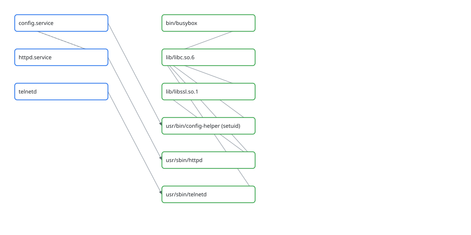

# R.A.I.N. ATLAS

**Scientific work that can be questioned, reproduced, and proved wrong.**

R.A.I.N. ATLAS is an **open-source, local-first research workbench** from [Vers3Dynamics](https://vers3dynamics.com). It runs computational experiments through versioned scientific skills, records the evidence behind each result, and makes independent challenges part of the workflow. Its **BLACK GLASS** subsystem applies the same discipline to offline firmware inspection.

[](pyproject.toml)
[](LICENSE)
[](CHANGELOG.md)
[](https://github.com/topherchris420/rain-atlas/actions)

**[Run an experiment](#run-your-first-experiment)** · **[Investigate firmware](#black-glass-firmware-intelligence)** · **[Inspect recorded evidence](#recorded-experiments)** · **[Browse the methods](#30-executable-scientific-skills)** · **[Understand the limits](#what-is-implemented-and-what-is-not)**


*This is a screenshot of the actual offline observatory, not a product mockup. The [recorded demonstration](docs/demonstration/) is a standalone HTML review snapshot: clone or download the repository, then open `docs/demonstration/index.html` locally.*

## What makes ATLAS different?

Most scientific software returns an answer. ATLAS also records **how the answer was obtained, what challenged it, and what remains unknown**.

| Capability | What you can actually do |
|---|---|
| **Computational experiments** | Run preregistered numerical studies with independent replications, controls, figures and reports. |
| **Scientific skepticism** | Challenge a primary result with another observable, a new dataset or an independently derived reference. |
| **Evidence ledger** | Preserve ordered records, inputs, code snapshots, hashes, challenges and verdicts; verify their internal consistency. |
| **Offline observatory** | Explore claims, evidence dependencies, runs, timelines, skills, reports and non-executing proposals in a local HTML file. |
| **BLACK GLASS** | Inventory authorized firmware, reconstruct static service/library relationships, inspect declared network surfaces, verify supplied trust anchors and compare releases. |
| **ORRERY** | Propagate orbits and N-body systems with a real force model, transform frames and time scales, estimate orbits and propagate covariance — validated against the analytic Kepler solution and NASA GMAT R2026a. |
| **30 executable skills** | Compose tested methods across signal processing, dynamical systems, physics, neuroscience, statistics, astrodynamics and evaluation. |

The built-in research roles are **scripted policies**, not autonomous LLM researchers. No live model provider or general-purpose AI agent is required or included in the demonstrations.

## Run your first experiment

**Requirements:** Git, [uv](https://docs.astral.sh/uv/getting-started/installation/) and Python 3.11 or 3.12. Installation downloads locked Python dependencies; the experiment then runs locally on CPU. No model account, cloud service or GPU is needed.

```sh
git clone https://github.com/topherchris420/rain-atlas.git
cd rain-atlas
uv sync --locked --python 3.12

# Preregister, execute, challenge, replicate and report.
uv run atlas experiment run synchronization --root atlas-data/sync-001 --replicates 12

# Check the evidence chain and referenced artifacts.
uv run atlas ledger verify atlas-data/sync-001/ledger
```

Open **`atlas-data/sync-001/observatory/index.html`** in your browser. The viewer is an offline export; it needs no web server or Node.js.

| Generated artifact | Why it matters |
|---|---|
| `observatory/index.html` | Follow claims to the runs, challenges and verdicts that support or contradict them. |
| `reports/report.md` and `reports/summary.json` | Read the complete result, acceptance checks and limitations, not just the successful cases. |
| `reports/synchronization-transition.png` / `.svg` | Inspect figures generated from the study. |
| `ledger/` | Inspect source snapshots, references and the append-only scientific record. |

**Use a fresh `--root` for each run.** ATLAS refuses to overwrite an existing ledger; automatic resume is not implemented. See the [end-to-end tutorial](docs/TUTORIAL.md) for trace/search, proposals, approvals, exports and recovery.

## BLACK GLASS: firmware intelligence

**A firmware image is evidence, not an executable to trust.**

BLACK GLASS is an **offline, read-only static-analysis subsystem** for firmware you are authorized to examine. Its pipeline imports an operator-provided tar/zip archive or extracted filesystem and constructs a reproducible model of its contents.

| Inspection | Output |
|---|---|
| Component inventory | File classifications, SHA-256 hashes, ELF metadata, shared-library dependencies and selected hardening properties. |
| Service mapping | Init/supervision declarations, executable relationships, declared dependencies and privilege-boundary annotations. |
| Network surface | Configuration port declarations and socket-related imports, explicitly labeled as **static indications**, not observed traffic. |
| Integrity verification | Hash-manifest and signature checks **only** against trust anchors provided by the operator. |
| Release comparison | Components, services, imports and declarations added, removed or changed across images. |
| Evidence integration | Findings with file-level references, cross-checks, confidence levels and ATLAS ledger records. |



*Actual generated service/dependency graph for the redistributable ExampleOS fixture. It is **not** a graph of a Synology device.*

### Reproduce the firmware demonstration

This example creates its **own synthetic firmware fixtures**. It does not download proprietary firmware, connect to a device or execute firmware code.

```sh
uv run python scripts/make_blackglass_fixtures.py --out atlas-data/bg-fixtures

uv run atlas firmware analyze atlas-data/bg-fixtures/fw-v1.tar.gz \
  --root atlas-data/bg-001 --label ExampleOS-v1 \
  --manifest atlas-data/bg-fixtures/manifest-v1.json \
  --signature atlas-data/bg-fixtures/fw-v1.tar.gz.sig \
  --public-key atlas-data/bg-fixtures/ed25519.pub \
  --signed-target atlas-data/bg-fixtures/fw-v1.tar.gz

uv run atlas ledger verify atlas-data/bg-001/ledger
uv run atlas firmware diff \
  atlas-data/bg-fixtures/fw-v1.tar.gz \
  atlas-data/bg-fixtures/fw-v2.tar.gz
```

The output includes an evidence-linked report, canonical JSON, a service graph, a version diff and an offline observatory. Prefer reading the committed [example report](docs/demonstration/blackglass/report.md), [graph](docs/demonstration/blackglass/graph.svg) and [diff](docs/demonstration/blackglass/diff.md) before running the pipeline.

You can also inspect your own supported firmware inputs:

```sh
uv run atlas firmware inventory ./extracted-rootfs --json
uv run atlas firmware analyze ./extracted-rootfs \
  --root atlas-data/my-firmware --label MyDevice-v1
```

BLACK GLASS **does not run firmware or establish runtime behavior**. Linking `bind`/`listen` does not prove that a service opens a listening socket. Without a trustworthy supplied key or manifest, authenticity cannot be established. Unsupported formats such as squashfs, cpio, raw flash and encrypted blobs must be handled by an appropriate authorized extraction workflow before analysis.

#### Synology DSM and Ghidra research

A specific research protocol identifies **Synology DS220+, DSM 7.2.2 build 72806** and explains local acquisition, nested-container constraints, and optional hash-bound native call-graph observations through a read-only Ghidra exporter.

**Official DSM binary analysis has not yet been performed.** The committed BLACK GLASS results come from controlled synthetic fixtures. The core pipeline does not decompile proprietary code. [IDA-Ghidra-bridge](https://github.com/oscarsantanaarias/IDA-Ghidra-bridge) is documented as an optional *manual exploration tool*, not a dependency or an automatically connected service.

[Technical documentation](docs/BLACK_GLASS.md) · [DSM research protocol](docs/BLACK_GLASS_DSM_RESEARCH.md) · [Native evidence and limitations](docs/BLACK_GLASS_DSM_RESEARCH.md#optional-function-level-native-analysis)

## How ATLAS decides what the evidence supports

ATLAS treats a scientific claim as a chain of accountable records:

```text
Question + hypothesis + controls + thresholds
                     │
             Preregistration
                     │
          Primary computation
                     │
      Independent check / challenge
                     │
        Reproduction + comparison
                     │
     Supported / contradicted / unresolved
                     │
          Evidence ledger → observatory
```

The verdict labels have deliberately narrow meanings:

- **Supported:** the preregistered criteria and independent checks corroborate the claim *within the stated model and limits*.
- **Contradicted:** a specified challenge or check contradicts the claim.
- **Unresolved:** the available evidence cannot justify either conclusion.

The ledger also distinguishes **OBSERVED** (empirical data), **COMPUTED** (a recorded successful calculation), and **INTERPRETED** (reasoning backed by computed or observed evidence). Synthetic observations are not mislabeled as empirical observations.

`atlas ledger verify` checks hash-chain continuity, referenced artifacts and record rules. **Integrity does not establish authorship, real-world validity or scientific truth.** The observatory is a privacy-reduced derived export; review its text and figures before sharing.

[Evidence model](docs/ARCHITECTURE.md) · [Observatory and export boundaries](docs/OBSERVATORY.md) · [Security model](SECURITY.md)

## Recorded experiments

These are **executed, documented synthetic studies**, not claims of physical-world validation.

### 01 / Synchronization under noise

Two simulated oscillators are tested across combinations of coupling strength, noise and phase lag. ATLAS compares temporal phase locking with relative-frequency drift, checks independent trajectories and uses an analytical reference where appropriate.


The committed study covers **30 conditions**, with **12 trajectories per condition** and a separate 12-trajectory replication ensemble. The recorded outcomes are **5 supported, 10 unresolved and 15 contradicted** operational locking claims. All five preregistered acceptance checks passed.

That result is bounded to this finite-window synthetic model. It is not evidence of a physical phase transition.

[Full report](docs/demonstration/report.md) · [Structured results](docs/demonstration/summary.json) · [Provenance](docs/demonstration/README.md) · [Numerical assumptions](docs/RESONANCE.md)

### 02 / Recovering frequencies from noisy signals

A second experiment tests Welch spectral analysis, nonlinear least-squares fitting, BIC model selection and independent regression tests across known synthetic tones, including a noise-only control.

```sh
uv run atlas experiment run spectral-recovery --root atlas-data/spectral-001
uv run atlas ledger verify atlas-data/spectral-001/ledger
uv run atlas observatory export \
  atlas-data/spectral-001/ledger --out atlas-data/spectral-view
```

Open `atlas-data/spectral-view/index.html`. The default `--mode fixed` uses published frequencies and is **not blind**. The optional `--mode blinded` generates a new truth and seals a commitment, but does not conceal that truth from the host.

### 03 / Where frequency-recovery methods fail

```sh
uv run atlas benchmark --root atlas-data/bench-001 --trials 12
```

The benchmark includes separated and close tones, colored and white noise, chirps and amplitude modulation. In the recorded colored-noise case, **both compared methods produced false detections in all 12 trials**. This is an important negative result, not a claim about every colored-noise setting.

[Benchmark protocol](docs/BENCHMARKS.md) · [Recorded output](docs/demonstration/benchmark.json) · [Validation details](docs/VALIDATION.md)

## 30 executable scientific skills

Skills combine executable Python, a typed manifest, explicit permissions and limits, documented assumptions, and examples with independently derived expected answers.

```sh
uv run atlas skills list
uv run atlas skills inspect phase-locking
uv run atlas skills test
```

<details>
<summary><strong>Expand the complete built-in skill catalog</strong></summary>

| Skill | Field | Method or purpose |
|---|---|---|
| [`synthetic-tones`](skills/simulation/synthetic-tones/SKILL.md) | Simulation | Seeded multi-tone signals in white noise |
| [`spectral-peaks`](skills/signal-processing/spectral-peaks/SKILL.md) | Signal processing | Welch PSD and line detection |
| [`sinusoid-fit`](skills/mathematics/sinusoid-fit/SKILL.md) | Mathematics | Nonlinear least squares and BIC model choice |
| [`tone-presence-test`](skills/statistics/tone-presence-test/SKILL.md) | Statistics | Independent F-tests for claimed frequencies |
| [`method-agreement`](skills/evaluation/method-agreement/SKILL.md) | Evaluation | Per-item agreement between estimators |
| [`recovery-score`](skills/evaluation/recovery-score/SKILL.md) | Evaluation | Recovery, bias, RMSE and CRLB efficiency |
| [`scientific-figure`](skills/visualization/scientific-figure/SKILL.md) | Visualization | Deterministic PNG/SVG scientific figures |
| [`pendulum-period`](skills/computational-physics/pendulum-period/SKILL.md) | Physics | Nonlinear pendulum period via ODE integration |
| [`lyapunov-exponent`](skills/dynamical-systems/lyapunov-exponent/SKILL.md) | Dynamics | Logistic-map and Lorenz exponents |
| [`spike-train-statistics`](skills/neuroscience/spike-train-statistics/SKILL.md) | Neuroscience | Rate, ISI CV, Fano factor, refractory violations |
| [`bibliography-audit`](skills/literature/bibliography-audit/SKILL.md) | Literature | Offline BibTeX validation and duplicates |
| [`stft-analysis`](skills/signal-processing/stft-analysis/SKILL.md) | Signal processing | Hann-window time-frequency density |
| [`morlet-wavelet`](skills/signal-processing/morlet-wavelet/SKILL.md) | Signal processing | Complex Morlet transform and edge mask |
| [`phase-locking`](skills/resonance/phase-locking/SKILL.md) | Resonance | Multichannel PLV and order parameter |
| [`kuramoto-network`](skills/dynamical-systems/kuramoto-network/SKILL.md) | Dynamics | Coupled stochastic/deterministic oscillators |
| [`adaptive-filter`](skills/signal-processing/adaptive-filter/SKILL.md) | Signal processing | LMS and normalized LMS filtering |
| [`fir-identification`](skills/dynamical-systems/fir-identification/SKILL.md) | Dynamics | FIR identification and residual uncertainty |
| [`plate-eigenmode`](skills/computational-physics/plate-eigenmode/SKILL.md) | Physics | Supported thin-plate eigenmodes |
| [`cross-spectral`](skills/signal-processing/cross-spectral/SKILL.md) | Signal processing | Cross-spectrum and magnitude-squared coherence |
| [`synchronization-sweep`](skills/resonance/synchronization-sweep/SKILL.md) | Resonance | Noisy phase-lagged oscillator sweeps |
| [`synchronization-measure`](skills/resonance/synchronization-measure/SKILL.md) | Resonance | Frequency/phase metrics and replicate intervals |
| [`spectral-stress-benchmark`](skills/evaluation/spectral-stress-benchmark/SKILL.md) | Evaluation | Failures, disagreement and unknown-truth cases |
| [`orbit-propagation`](skills/astrodynamics/orbit-propagation/SKILL.md) | Astrodynamics | Propagate an orbit under configurable gravity with conservation diagnostics |
| [`kepler-reference`](skills/astrodynamics/kepler-reference/SKILL.md) | Astrodynamics | Closed-form two-body propagation and classical elements |
| [`trajectory-comparison`](skills/astrodynamics/trajectory-comparison/SKILL.md) | Astrodynamics | Position/velocity and RTN error against a reference trajectory |
| [`earth-orientation`](skills/astrodynamics/earth-orientation/SKILL.md) | Astrodynamics | MJ2000Eq ↔ EarthFixed via the IAU-76/80 FK5 reduction |
| [`tracking-simulation`](skills/astrodynamics/tracking-simulation/SKILL.md) | Astrodynamics | Synthetic range and range-rate from ground stations |
| [`orbit-determination`](skills/astrodynamics/orbit-determination/SKILL.md) | Astrodynamics | Batch least-squares orbit determination from tracking |
| [`covariance-propagation`](skills/astrodynamics/covariance-propagation/SKILL.md) | Astrodynamics | STM covariance propagation with a Monte-Carlo check |
| [`nbody-integration`](skills/astrodynamics/nbody-integration/SKILL.md) | Astrodynamics | Self-gravitating N-body (figure-eight or DE421 subset) |

</details>

To contribute a method, follow the [skill authoring guide](docs/SKILL_AUTHORING.md). New skills must include executable tests and answers that are **independently established**, not copied from their own output.

## What is implemented, and what is not

**Version 0.1.0 is unreleased.** ATLAS currently includes the numerical experiments above, a 30-skill catalog, evidence search and recovery, an offline observatory, local proposal registration/approval, export integrations, and BLACK GLASS static firmware analysis.

**Validation snapshot:** the [November 5, 2026 Linux record](docs/VALIDATION.md) reports **235 passing tests and one platform-specific skip** on each of Python 3.11 and 3.12, including the slow acceptance tests. It also documents cross-platform agreement and defects found through validation. These are historical recorded results, **not a claim that every subsequent commit has been retested**. See [GitHub Actions](https://github.com/topherchris420/rain-atlas/actions) for the current hosted workflow state; hosted CI was account-blocked at the time of the published validation.

Important boundaries:

- The executor enforces declared permissions and resource bounds, **but is not a hardened sandbox for hostile code**.
- Live model providers, unrestricted agent execution, generic proposal scheduling, automatic experiment resume and accelerator backends are not implemented.
- BLACK GLASS works on supported **offline inputs**. Static imports and configuration statements are not evidence of live-device behavior.
- The checked-in BLACK GLASS demonstration is **synthetic**; no verified analysis of an official DSM executable is claimed.
- A checked ledger proves record consistency, not external authenticity or scientific correctness.

[Current implementation status](docs/STATUS.md) · [Known limitations](docs/WORKBENCH_LIMITATIONS.md) · [Security](SECURITY.md) · [Changelog](CHANGELOG.md)

## Documentation and contributions

| Read | When you need |
|---|---|
| [Tutorial](docs/TUTORIAL.md) | A complete question-to-evidence workflow |
| [Architecture](docs/ARCHITECTURE.md) | Component relationships and planned boundaries |
| [BLACK GLASS](docs/BLACK_GLASS.md) | Firmware pipeline, CLI, confidence model and validation |
| [DSM research protocol](docs/BLACK_GLASS_DSM_RESEARCH.md) | Identified artifact, acquisition protocol and native-evidence workflow |
| [Skill authoring](docs/SKILL_AUTHORING.md) | Creating and testing another numerical method |
| [Resonance methods](docs/RESONANCE.md) | Mathematical assumptions and reference formulas |
| [Observatory](docs/OBSERVATORY.md) | Offline UI, export privacy and review behavior |
| [Integration contracts](docs/INTEGRATION.md) | R.A.I.N. export and quarantined Luca intake |
| [Validation](docs/VALIDATION.md) | Executed tests, failures and reproduction details |
| [Architecture decisions](docs/adr/) | Recorded design tradeoffs |

Before submitting a change, run:

```sh
uv run python scripts/check.py
```

The check script runs formatting, lint, targeted scientific types, skill validation and Python tests. See [CONTRIBUTING.md](CONTRIBUTING.md) for browser-test setup and the contribution process. Keep failed experiments visible; never rewrite historical evidence to make a result look better.

## License and independence

[MIT licensed](LICENSE) · © 2026 Vers3Dynamics · [Notice](NOTICE.md) · [Responsible use](RESPONSIBLE_AI.md) · [Code of conduct](CODE_OF_CONDUCT.md)

R.A.I.N. ATLAS is an independent Vers3Dynamics project. It is not affiliated with or endorsed by the U.S. Department of Energy or the Genesis Mission.

**A useful research instrument does not have to agree with its inventor.**
