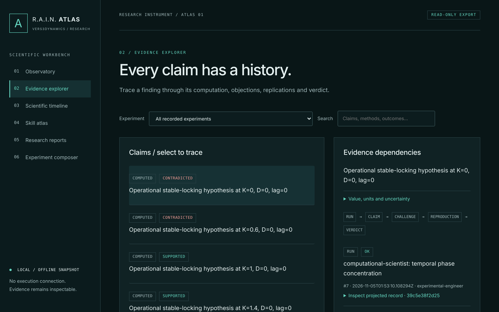
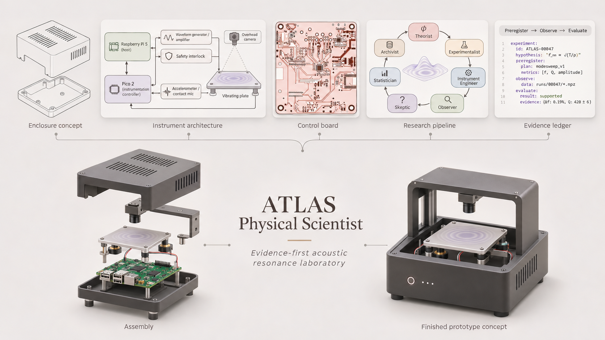
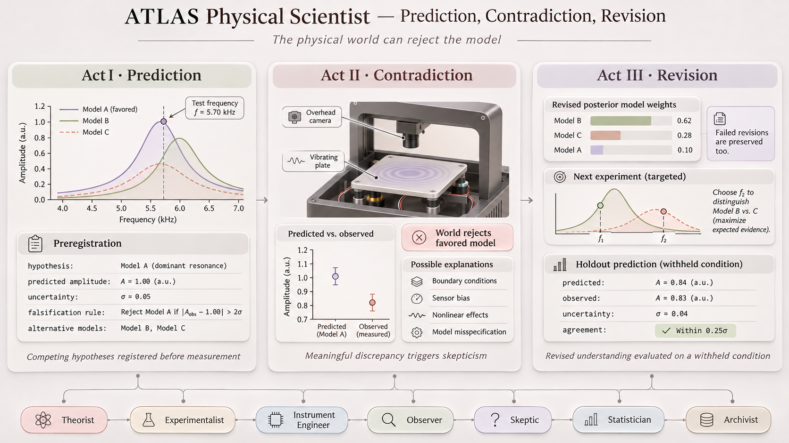
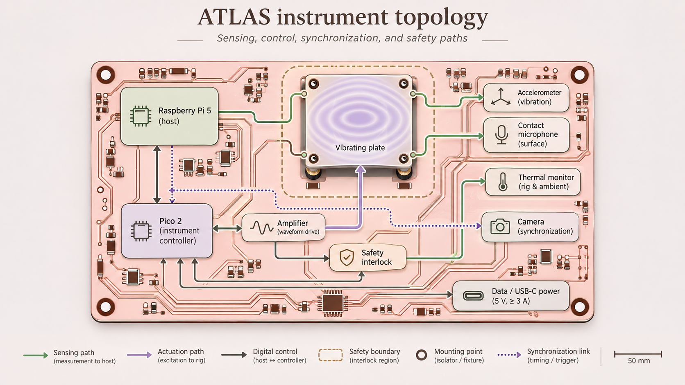
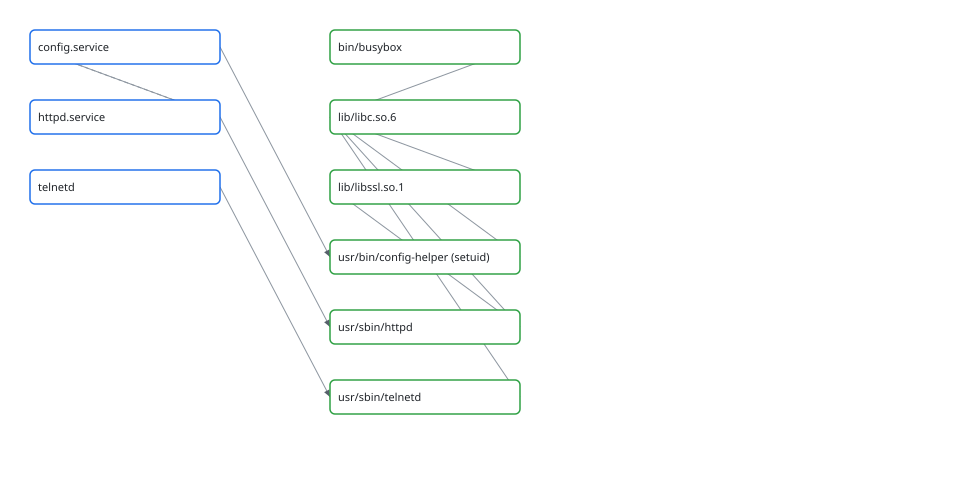
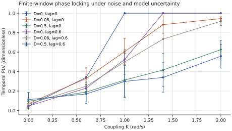

# R.A.I.N. ATLAS

**Follow a scientific claim from the experiment that produced it to the challenge that could overturn it.**

**R.A.I.N.** stands for **Recursive Architecture of Intelligent Nexus**.

R.A.I.N. ATLAS is an **open-source, local-first research workbench** from [Vers3Dynamics](https://vers3dynamics.com). It runs computational experiments through versioned scientific skills, records the evidence behind each result, and makes independent challenges part of the workflow. Its **BLACK GLASS** subsystem applies the same discipline to offline firmware inspection.

[](pyproject.toml)
[](LICENSE)
[](https://github.com/topherchris420/rain-atlas/releases/tag/v0.1.0)
[](https://github.com/topherchris420/rain-atlas/actions)

**[Run an autonomous investigation](#autonomous-research)** · **[Explore Physical Scientist](#atlas-physical-scientist)** · **[Run an experiment](#run-your-first-experiment)** · **[Investigate firmware](#black-glass-firmware-intelligence)** · **[Inspect recorded evidence](#recorded-experiments)** · **[Browse the methods](#31-executable-scientific-skills)** · **[Understand the limits](#what-is-implemented-and-what-is-not)**



*This is a screenshot of the actual offline observatory, not a product mockup. The [recorded demonstration](docs/demonstration/) is a standalone HTML review snapshot: clone or download the repository, then open `docs/demonstration/index.html` locally.*


**Run the integrated demonstrations:**

```bash
# One scientific mission through every module (proposal → protocol →
# approval → experiments → evaluation → replication → ledger):
uv run atlas rain slice --root atlas-data/rain-slice
uv run atlas ledger verify atlas-data/rain-slice/ledger

# The central scientific experiment: does persistent memory make a research
# system more efficient without making it wrong, even when the world changes?
uv run atlas rain central --root atlas-data/rain-central
uv run atlas ledger verify atlas-data/rain-central/ledger
```

The central experiment runs 1,200 missions per arm across stationary worlds and
worlds whose hidden model changes without notice. It compares memory that
must be confirmed by fresh evidence, memory that is trusted blindly, no
memory, and fixed and random designs, under four preregistered hypotheses
with Bonferroni-adjusted intervals. **Recorded outcome:** verified memory
saves 26.9 % of experiments (interval 24.3–29.5 %, so the preregistered
"≥25 %" claim is *unresolved*) while adding no detectable false conclusions.
Blindly trusted memory reaches a false conclusion in 91 % of missions after
the world changes. An ordering control shows the "adaptive" selection
advantage is a fixed-ordering effect.

The first protocol of this experiment reported a 68 % saving that its design
guaranteed; it remains reproducible with `--protocol v1`. See
[docs/CENTRAL_EXPERIMENT.md](docs/CENTRAL_EXPERIMENT.md) for the design, the
full results and why v1 was superseded.

## Autonomous research

**Give ATLAS a question and an approved scope; it decides what to test next because of what it has seen.**

`atlas research` runs a complete investigation within a charter a human approves (question, permitted methods, budgets, execution environment). Inside that scope the research loop forms competing hypotheses, preregisters them, chooses each experiment to maximize expected information about the explanations still in contention, records its prediction before every run, notices when its model is inadequate, admits or rejects new hypotheses on exact evidence, challenges its conclusions with fresh data and an independent method, and stops for a stated reason. Anything outside the scope (more experiments, a wider design space, new hypothesis terms) becomes an escalation request for a human. Hardware control and untrusted code have no execution path at all. Every step is in the evidence ledger; an interrupted mission resumes by replaying the record and verifying each regenerated event.

```bash
uv run atlas research demo --root atlas-data/research     # default charter, labeled proxy approval
uv run atlas ledger verify atlas-data/research/ledger
```

The question it was built to answer, investigated on a simulated noisy driven oscillator with hidden changes, unanticipated terms, stale memories and heavy-tailed noise:

> Can an intelligent experimental system detect previously unknown changes in a noisy dynamical system, determine what changed, and develop a better explanatory model using fewer experiments than conventional methods?

**Recorded answer: supported, with conditions.** On 200 held-out problems, preregistered and pushed before the run, the closed loop needed fewer experiments to a correct conclusion than a yoked control that replays its own designs from a different problem (−1.14 experiments, adjusted interval [−1.85, −0.45]), and fewer than open-loop D-optimal design, a fixed sweep, random designs and the existing ATLAS rule. It identified hidden changes far more often than a fixed sweep (64 % vs 18 %) and found unanticipated terms more often (36 % vs 4 %). **The safety hypothesis is unresolved:** the closed loop made a false conclusion on 10 of 200 held-out problems, or 5.0 % (adjusted interval 1.5–10.9 % against a 5 % bound). It never identified the held-out-only cubic-damping term, and it missed 6 of 19 stale memories. The preregistration had predicted the observation-dependence test would be unresolved.

[Design and limits](docs/RESEARCH.md) · [Preregistration](docs/research/PREREGISTRATION.md) · [Recorded investigation and dossier](docs/demonstration/research/)

## ATLAS Physical Scientist

**A hypothesis is only useful if reality is allowed to reject it.** This extension introduces a reproducible *software* loop for competing resonance models: preregister a predicted response, select a discriminating frequency, preserve an observation, score the mismatch, and retain failed revisions. It reuses the original evidence ledger and offline observatory.

> **Evidence boundary:** The runnable three-act demonstration is **simulation-only**. Hardware and circuit illustrations below are **design concepts**, not KiCad schematics, routed PCBs, validated CAD, completed enclosures, physical measurements, or manufacturing instructions. The measurement-import path accepts operator-attested CSV data but cannot authenticate a physical instrument. There is no actuator-control path.



*Figure 1. ATLAS Physical Scientist, an editorial concept rendering of the proposed acoustic resonance apparatus, exploded assembly and research architecture. **This is artwork, not an engineering CAD model, tested circuit, or physical prototype.**

### Prediction, contradiction, revision



*Figure 2. **Illustrative, not experimental data.** The pictured frequencies, amplitudes, curves, uncertainty values, and posterior weights are artist-rendered examples, **not output from the implemented ATLAS demonstration**. For authentic synthetic results and negative outcomes, run the reproducible software experiment and inspect its evidence ledger.*

### Proposed sensing and safety architecture



*Figure 3. **Concept art, not a real PCB layout or electrical schematic.** Illustrated traces, components, signal directions, the scale bar and power labels are not specified or validated engineering geometry. No physical interlock or wiring design is provided. **Do not manufacture or wire hardware from this image.**

### Supporting vector documentation

The earlier editable diagrams remain in the repository as simplified reference visuals, not validated fabrication files: [system concept](docs/figures/atlas-system-concept.svg), [scientific loop](docs/figures/atlas-scientific-loop.svg), and [instrument topology](docs/figures/atlas-instrument-topology.svg).

| Available now | Not yet demonstrated |
|---|---|
| Preregistered competing linear surrogate models and an adaptive disagreement selector | AI-generated novel physical theories or measured superiority to baseline design methods |
| Deterministic uncertainty scoring and stored negative results | Real excitation, synchronous sensors, validated camera measurement, calibrated physical apparatus |
| Content-addressed records and read-only offline replay | Engineering-grade KiCad / Gerber / enclosure CAD, electrical validation and safe physical actuation |

**Try the simulation locally:**

~~~sh
uv sync --locked
uv run python scripts/physical_scientist.py demo --root atlas-data/physical-demo --seed 7
uv run atlas ledger verify atlas-data/physical-demo/ledger
~~~

Open `atlas-data/physical-demo/observatory/index.html` to inspect the source-labeled evidence. For the physical roadmap, risk gates, operator-attested import workflow and seven-lens review, read [ATLAS Physical Scientist: Engineering & Evidence](docs/PHYSICAL_SCIENTIST.md).


## What makes ATLAS different?

Most scientific software returns an answer. ATLAS also records **how the answer was obtained, what challenged it, and what remains unknown**.

| Capability | What you can actually do |
|---|---|
| **Computational experiments** | Run preregistered numerical studies with independent replications, controls, figures and reports. |
| **Scientific skepticism** | Challenge a primary result with another observable, a new dataset or an independently derived reference. |
| **Evidence ledger** | Preserve ordered records, inputs, code snapshots, hashes, challenges and verdicts; verify their internal consistency. |
| **Offline observatory** | Explore claims, evidence dependencies, runs, timelines, skills, reports and non-executing proposals in a local HTML file. |
| **BLACK GLASS** | Inventory authorized firmware, reconstruct static service/library relationships, inspect declared network surfaces, verify supplied trust anchors and compare releases. |
| **ORRERY** | Propagate orbits and N-body systems with a real force model, transform frames and time scales, estimate orbits and propagate covariance — validated against the analytic Kepler solution and NASA GMAT R2026a. |
| **Autonomous research** | Run a charter-scoped investigation: competing hypotheses, observation-dependent experiment choice, self-critique, challenges, escalation outside scope, verified resume. |
| **31 executable skills** | Compose tested methods across signal processing, dynamical systems, physics, neuroscience, statistics, astrodynamics and evaluation. |

The research loop is **deterministic code**, not an LLM agent: exact evidence, information-driven design and fixed verdict rules decide. A local Ollama model can be allowed as an *advisor* whose suggestions are validated and labeled; it never counts as evidence. No live model provider is required or used in the demonstrations.

## Run your first experiment

**Requirements:** Git, [uv](https://docs.astral.sh/uv/getting-started/installation/) and Python 3.11 or 3.12. Installation downloads locked Python dependencies; the experiment then runs locally on CPU. No model account, cloud service or GPU is needed.

```sh
git clone https://github.com/topherchris420/rain-atlas.git
cd rain-atlas
uv sync --locked --python 3.12

# Preregister, execute, challenge, replicate and report.
uv run atlas experiment run synchronization --root atlas-data/sync-001 --replicates 12

# Check the evidence chain and referenced artifacts.
uv run atlas ledger verify atlas-data/sync-001/ledger
```

Open **`atlas-data/sync-001/observatory/index.html`** in your browser. The viewer is an offline export; it needs no web server or Node.js.

| Generated artifact | Why it matters |
|---|---|
| `observatory/index.html` | Follow claims to the runs, challenges and verdicts that support or contradict them. |
| `reports/report.md` and `reports/summary.json` | Read the complete result, acceptance checks and limitations, not just the successful cases. |
| `reports/synchronization-transition.png` / `.svg` | Inspect figures generated from the study. |
| `ledger/` | Inspect source snapshots, references and the append-only scientific record. |

**Use a fresh `--root` for each run.** ATLAS refuses to overwrite an existing ledger; automatic resume is not implemented. See the [end-to-end tutorial](docs/TUTORIAL.md) for trace/search, proposals, approvals, exports and recovery.

### Install as a package

To use the `atlas` command without a checkout, install the released package. The wheel carries the built-in skill catalog and every data file it needs:

```sh
pip install rain-atlas          # or: uv tool install rain-atlas
atlas skills test
```

The [GitHub release](https://github.com/topherchris420/rain-atlas/releases/tag/v0.1.0) also carries the wheel, the sdist, `SHA256SUMS` and a CycloneDX SBOM. `uv run python scripts/check_package.py` builds the sdist and wheel from a checkout, checks their metadata as PyPI will, installs the wheel into a clean environment and runs the CLI from an unrelated directory. CI runs it on Linux and Windows.

To cut a release, either push a `vX.Y.Z` tag, or run the **release** workflow on `main` from the Actions tab with the version; a manual run creates the tag itself. Either way the version must match the package version and have notes in `docs/releases/`. The workflow builds and checks the package, publishes the GitHub release, and only then uploads to PyPI.

## BLACK GLASS: firmware intelligence

**A firmware image is evidence, not an executable to trust.**

BLACK GLASS is an **offline, read-only static-analysis subsystem** for firmware you are authorized to examine. Its pipeline imports an operator-provided tar/zip archive or extracted filesystem and constructs a reproducible model of its contents.

| Inspection | Output |
|---|---|
| Component inventory | File classifications, SHA-256 hashes, ELF metadata, shared-library dependencies and selected hardening properties. |
| Service mapping | Init/supervision declarations, executable relationships, declared dependencies and privilege-boundary annotations. |
| Network surface | Configuration port declarations and socket-related imports, explicitly labeled as **static indications**, not observed traffic. |
| Integrity verification | Hash-manifest and signature checks **only** against trust anchors provided by the operator. |
| Release comparison | Components, services, imports and declarations added, removed or changed across images. |
| Evidence integration | Findings with file-level references, cross-checks, confidence levels and ATLAS ledger records. |



*Actual generated service/dependency graph for the redistributable ExampleOS fixture. It is **not** a graph of a Synology device.*

### Reproduce the firmware demonstration

This example creates its **own synthetic firmware fixtures**. It does not download proprietary firmware, connect to a device or execute firmware code.

```sh
uv run python scripts/make_blackglass_fixtures.py --out atlas-data/bg-fixtures

uv run atlas firmware analyze atlas-data/bg-fixtures/fw-v1.tar.gz \
  --root atlas-data/bg-001 --label ExampleOS-v1 \
  --manifest atlas-data/bg-fixtures/manifest-v1.json \
  --signature atlas-data/bg-fixtures/fw-v1.tar.gz.sig \
  --public-key atlas-data/bg-fixtures/ed25519.pub \
  --signed-target atlas-data/bg-fixtures/fw-v1.tar.gz

uv run atlas ledger verify atlas-data/bg-001/ledger
uv run atlas firmware diff \
  atlas-data/bg-fixtures/fw-v1.tar.gz \
  atlas-data/bg-fixtures/fw-v2.tar.gz
```

The output includes an evidence-linked report, canonical JSON, a service graph, a version diff and an offline observatory. Prefer reading the committed [example report](docs/demonstration/blackglass/report.md), [graph](docs/demonstration/blackglass/graph.svg) and [diff](docs/demonstration/blackglass/diff.md) before running the pipeline.

You can also inspect your own supported firmware inputs:

```sh
uv run atlas firmware inventory ./extracted-rootfs --json
uv run atlas firmware analyze ./extracted-rootfs \
  --root atlas-data/my-firmware --label MyDevice-v1
```

BLACK GLASS **does not run firmware or establish runtime behavior**. Linking `bind`/`listen` does not prove that a service opens a listening socket. Without a trustworthy supplied key or manifest, authenticity cannot be established. Unsupported formats such as squashfs, cpio, raw flash and encrypted blobs must be handled by an appropriate authorized extraction workflow before analysis.

#### Synology DSM and Ghidra research

A specific research protocol identifies **Synology DS220+, DSM 7.2.2 build 72806** and explains local acquisition, nested-container constraints, and optional hash-bound native call-graph observations through a read-only Ghidra exporter.

The acquired DSM image was encrypted, so the DSM executables remain unexamined. The service graph above comes from synthetic fixtures. A separate native study used headless Ghidra on a licensed BusyBox ELF and checked clean-room models of three routines against published test vectors.

[Technical documentation](docs/BLACK_GLASS.md) · [DSM research protocol](docs/BLACK_GLASS_DSM_RESEARCH.md) · [BusyBox evidence and reconstruction](docs/BLACK_GLASS_NATIVE.md)

## How ATLAS decides what the evidence supports

ATLAS treats a scientific claim as a chain of accountable records:

```text
Question + hypothesis + controls + thresholds
                     │
             Preregistration
                     │
          Primary computation
                     │
      Independent check / challenge
                     │
        Reproduction + comparison
                     │
     Supported / contradicted / unresolved
                     │
          Evidence ledger → observatory
```

The verdict labels have deliberately narrow meanings:

- **Supported:** the preregistered criteria and independent checks corroborate the claim *within the stated model and limits*.
- **Contradicted:** a specified challenge or check contradicts the claim.
- **Unresolved:** the available evidence cannot justify either conclusion.

The ledger also distinguishes **OBSERVED** (empirical data), **COMPUTED** (a recorded successful calculation), and **INTERPRETED** (reasoning backed by computed or observed evidence). Synthetic observations are not mislabeled as empirical observations.

`atlas ledger verify` checks hash-chain continuity, referenced artifacts and record rules. **Integrity does not establish authorship, real-world validity or scientific truth.** The observatory is a privacy-reduced derived export; review its text and figures before sharing.

[Evidence model](docs/ARCHITECTURE.md) · [Observatory and export boundaries](docs/OBSERVATORY.md) · [Security model](SECURITY.md)

## Recorded experiments

These are **executed, documented synthetic studies**, not claims of physical-world validation.

### 01 / Synchronization under noise

Two simulated oscillators are tested across combinations of coupling strength, noise and phase lag. ATLAS compares temporal phase locking with relative-frequency drift, checks independent trajectories and uses an analytical reference where appropriate.



The committed study covers **30 conditions**, with **12 trajectories per condition** and a separate 12-trajectory replication ensemble. The recorded outcomes are **5 supported, 10 unresolved and 15 contradicted** operational locking claims. All five preregistered acceptance checks passed.

That result is bounded to this finite-window synthetic model. It is not evidence of a physical phase transition.

[Full report](docs/demonstration/report.md) · [Structured results](docs/demonstration/summary.json) · [Provenance](docs/demonstration/README.md) · [Numerical assumptions](docs/RESONANCE.md)

### 02 / Recovering frequencies from noisy signals

A second experiment tests Welch spectral analysis, nonlinear least-squares fitting, BIC model selection and independent regression tests across known synthetic tones, including a noise-only control.

```sh
uv run atlas experiment run spectral-recovery --root atlas-data/spectral-001
uv run atlas ledger verify atlas-data/spectral-001/ledger
uv run atlas observatory export \
  atlas-data/spectral-001/ledger --out atlas-data/spectral-view
```

Open `atlas-data/spectral-view/index.html`. The default `--mode fixed` uses published frequencies and is **not blind**. The optional `--mode blinded` generates a new truth and seals a commitment, but does not conceal that truth from the host.

### 03 / Where frequency-recovery methods fail

```sh
uv run atlas benchmark --root atlas-data/bench-001 --trials 12
```

The benchmark includes separated and close tones, colored and white noise, chirps and amplitude modulation. In the recorded colored-noise case, **both compared methods produced false detections in all 12 trials**. This is an important negative result, not a claim about every colored-noise setting.

[Benchmark protocol](docs/BENCHMARKS.md) · [Recorded output](docs/demonstration/benchmark.json) · [Validation details](docs/VALIDATION.md)

### 04 / Calibrating a search across an entire spectrum

The stress benchmark exposed a failure in colored noise. This follow-up compares the original Welch detector with detectors calibrated on independent blank windows and measures the trade-off between false alarms and tone sensitivity. An oscillatory noise-only control tests what happens when neither reference model matches.

```sh
uv run atlas benchmark --protocol spectral-calibration --root atlas-data/calibration
uv run atlas ledger verify atlas-data/calibration/ledger
```

In 512 AR(1) noise-only trials, the reference panel reported **2 false alarms** and the original Welch threshold reported **512**. The panel localized every strong injected tone, missed every weak one and flagged every out-of-panel oscillatory noise trial.

[Protocol, results and limits](docs/BENCHMARKS.md#held-out-spectral-calibration) · [Recorded JSON](docs/demonstration/spectral-calibration.json)

## 31 executable scientific skills

Skills combine executable Python, a typed manifest, explicit permissions and limits, documented assumptions, and examples with independently derived expected answers.

```sh
uv run atlas skills list
uv run atlas skills inspect phase-locking
uv run atlas skills test
```

<details>
<summary><strong>Expand the complete built-in skill catalog</strong></summary>

| Skill | Field | Method or purpose |
|---|---|---|
| [`synthetic-tones`](skills/simulation/synthetic-tones/SKILL.md) | Simulation | Seeded multi-tone signals in white noise |
| [`spectral-peaks`](skills/signal-processing/spectral-peaks/SKILL.md) | Signal processing | Welch PSD and line detection |
| [`sinusoid-fit`](skills/mathematics/sinusoid-fit/SKILL.md) | Mathematics | Nonlinear least squares and BIC model choice |
| [`tone-presence-test`](skills/statistics/tone-presence-test/SKILL.md) | Statistics | Independent F-tests for claimed frequencies |
| [`method-agreement`](skills/evaluation/method-agreement/SKILL.md) | Evaluation | Per-item agreement between estimators |
| [`recovery-score`](skills/evaluation/recovery-score/SKILL.md) | Evaluation | Recovery, bias, RMSE and CRLB efficiency |
| [`scientific-figure`](skills/visualization/scientific-figure/SKILL.md) | Visualization | Deterministic PNG/SVG scientific figures |
| [`pendulum-period`](skills/computational-physics/pendulum-period/SKILL.md) | Physics | Nonlinear pendulum period via ODE integration |
| [`lyapunov-exponent`](skills/dynamical-systems/lyapunov-exponent/SKILL.md) | Dynamics | Logistic-map and Lorenz exponents |
| [`spike-train-statistics`](skills/neuroscience/spike-train-statistics/SKILL.md) | Neuroscience | Rate, ISI CV, Fano factor, refractory violations |
| [`bibliography-audit`](skills/literature/bibliography-audit/SKILL.md) | Literature | Offline BibTeX validation and duplicates |
| [`stft-analysis`](skills/signal-processing/stft-analysis/SKILL.md) | Signal processing | Hann-window time-frequency density |
| [`morlet-wavelet`](skills/signal-processing/morlet-wavelet/SKILL.md) | Signal processing | Complex Morlet transform and edge mask |
| [`phase-locking`](skills/resonance/phase-locking/SKILL.md) | Resonance | Multichannel PLV and order parameter |
| [`kuramoto-network`](skills/dynamical-systems/kuramoto-network/SKILL.md) | Dynamics | Coupled stochastic/deterministic oscillators |
| [`adaptive-filter`](skills/signal-processing/adaptive-filter/SKILL.md) | Signal processing | LMS and normalized LMS filtering |
| [`fir-identification`](skills/dynamical-systems/fir-identification/SKILL.md) | Dynamics | FIR identification and residual uncertainty |
| [`plate-eigenmode`](skills/computational-physics/plate-eigenmode/SKILL.md) | Physics | Supported thin-plate eigenmodes |
| [`cross-spectral`](skills/signal-processing/cross-spectral/SKILL.md) | Signal processing | Cross-spectrum and magnitude-squared coherence |
| [`synchronization-sweep`](skills/resonance/synchronization-sweep/SKILL.md) | Resonance | Noisy phase-lagged oscillator sweeps |
| [`synchronization-measure`](skills/resonance/synchronization-measure/SKILL.md) | Resonance | Frequency/phase metrics and replicate intervals |
| [`spectral-stress-benchmark`](skills/evaluation/spectral-stress-benchmark/SKILL.md) | Evaluation | Failures, disagreement and unknown-truth cases |
| [`spectral-calibration-benchmark`](skills/evaluation/spectral-calibration-benchmark/SKILL.md) | Evaluation | Held-out reference calibration, noise shift and tone localization |
| [`orbit-propagation`](skills/astrodynamics/orbit-propagation/SKILL.md) | Astrodynamics | Propagate an orbit under configurable gravity with conservation diagnostics |
| [`kepler-reference`](skills/astrodynamics/kepler-reference/SKILL.md) | Astrodynamics | Closed-form two-body propagation and classical elements |
| [`trajectory-comparison`](skills/astrodynamics/trajectory-comparison/SKILL.md) | Astrodynamics | Position/velocity and RTN error against a reference trajectory |
| [`earth-orientation`](skills/astrodynamics/earth-orientation/SKILL.md) | Astrodynamics | MJ2000Eq ↔ EarthFixed via the IAU-76/80 FK5 reduction |
| [`tracking-simulation`](skills/astrodynamics/tracking-simulation/SKILL.md) | Astrodynamics | Synthetic range and range-rate from ground stations |
| [`orbit-determination`](skills/astrodynamics/orbit-determination/SKILL.md) | Astrodynamics | Batch least-squares orbit determination from tracking |
| [`covariance-propagation`](skills/astrodynamics/covariance-propagation/SKILL.md) | Astrodynamics | STM covariance propagation with a Monte-Carlo check |
| [`nbody-integration`](skills/astrodynamics/nbody-integration/SKILL.md) | Astrodynamics | Self-gravitating N-body (figure-eight or DE421 subset) |

</details>

To contribute a method, follow the [skill authoring guide](docs/SKILL_AUTHORING.md). New skills must include executable tests and answers that are **independently established**, not copied from their own output.

## What is implemented, and what is not

**Version 0.1.0 was released on November 17, 2026** ([release notes](docs/releases/v0.1.0.md)). It includes the numerical experiments above, a 31-skill catalog, evidence search and recovery, an offline observatory, local proposal registration/approval, export integrations, BLACK GLASS static firmware analysis, and the REA replication framework with eight reconstructed-capability modules and the unified `atlas rain` demonstrations.

**Validation snapshot:** the [November 17, 2026 Linux record](docs/STATUS.md#validation-record) reports **674 passing tests and two platform-specific skips** on Python 3.12, including the slow acceptance tests, plus an installed-wheel run outside the checkout. The [November 5 record](docs/VALIDATION.md) documents cross-platform agreement and defects found through validation. These are historical recorded results, **not a claim that every subsequent commit has been retested**. See [GitHub Actions](https://github.com/topherchris420/rain-atlas/actions) for the current hosted workflow state. The first hosted run on record (November 17) passed every job on Linux and Windows with Python 3.11 and 3.12, including the installed-wheel check; earlier runs were blocked at the account level.

Important boundaries:

- The executor enforces declared permissions and resource bounds, **but is not a hardened sandbox for hostile code**.
- Unrestricted agent execution, hosted model providers and accelerator backends are not implemented. Adaptive scheduling and verified resume exist inside `atlas research` missions; the original experiments still refuse to resume. The optional local Ollama advisor is tested only against a simulated server.
- `atlas research` is demonstrated on one simulated domain; its generality is designed, not demonstrated.
- BLACK GLASS works on supported **offline inputs**. Static imports and configuration statements are not evidence of live-device behavior.
- The checked-in BLACK GLASS demonstration is **synthetic**; no verified analysis of an official DSM executable is claimed.
- A checked ledger proves record consistency, not external authenticity or scientific correctness.

[Current implementation status](docs/STATUS.md) · [Known limitations](docs/WORKBENCH_LIMITATIONS.md) · [Security](SECURITY.md) · [Changelog](CHANGELOG.md)

## Documentation and contributions

| Read | When you need |
|---|---|
| [Tutorial](docs/TUTORIAL.md) | A complete question-to-evidence workflow |
| [Architecture](docs/ARCHITECTURE.md) | Component relationships and planned boundaries |
| [BLACK GLASS](docs/BLACK_GLASS.md) | Firmware pipeline, CLI, confidence model and validation |
| [DSM research protocol](docs/BLACK_GLASS_DSM_RESEARCH.md) | Identified artifact, acquisition protocol and native-evidence workflow |
| [Skill authoring](docs/SKILL_AUTHORING.md) | Creating and testing another numerical method |
| [Resonance methods](docs/RESONANCE.md) | Mathematical assumptions and reference formulas |
| [Observatory](docs/OBSERVATORY.md) | Offline UI, export privacy and review behavior |
| [Integration contracts](docs/INTEGRATION.md) | R.A.I.N. export and quarantined Luca intake |
| [Validation](docs/VALIDATION.md) | Executed tests, failures and reproduction details |
| [Architecture decisions](docs/adr/) | Recorded design tradeoffs |

Before submitting a change, run:

```sh
uv run python scripts/check.py
```

The check script runs formatting, lint, targeted scientific types, skill validation and Python tests. See [CONTRIBUTING.md](CONTRIBUTING.md) for browser-test setup and the contribution process. Keep failed experiments visible; never rewrite historical evidence to make a result look better.

## License and independence

[MIT licensed](LICENSE) · © 2026 Vers3Dynamics · [Notice](NOTICE.md) · [Responsible use](RESPONSIBLE_AI.md) · [Code of conduct](CODE_OF_CONDUCT.md)

R.A.I.N. ATLAS is an independent Vers3Dynamics project. It is not affiliated with or endorsed by the U.S. Department of Energy or the Genesis Mission.

**A useful research instrument does not have to agree with its inventor.**


