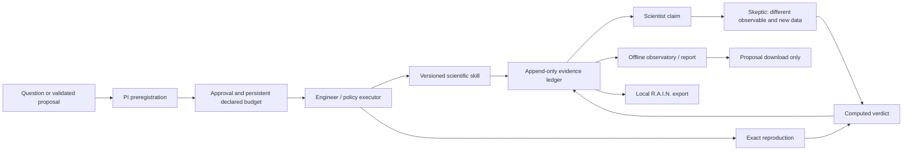

# R.A.I.N. ATLAS — Architecture Specification

Status: **evolving design**. The implementation boundary below is current;
later sections retain the original long-term specification. Sections describe intended behaviour;
the implementation status of each part lives in [`STATUS.md`](STATUS.md) and is
only updated when the part's acceptance tests have actually run.

R.A.I.N. ATLAS is an independent, open-source Vers3Dynamics project. It is not
affiliated with, endorsed by, or part of the U.S. Department of Energy, the
Genesis Mission, or the Genesis Skills project. It studies those projects as
public references only (see [`docs/REFERENCES.md`](REFERENCES.md)).

> Resonance as substrate. Intelligence as a layer. Evidence as the foundation.

## Implemented workbench boundary (2026-11-04)

The original registry, executor, ledger and scripted roles remain intact.
New numerical methods are ordinary functions under `rain_atlas.science`;
thin typed skill wrappers run through the same engineer and executor.
`rain_atlas.observatory` exports standalone HTML/CSS/JS. It is not a service.



Runs retain deterministic ZIP snapshots of engine and skill sources, a source
tree digest, dependency lockfile, inputs and output objects. Exact reproduction
refuses changed engine or skill source. The ZIP is inspectable, never executed
or extracted automatically. A derived SQLite index accelerates search after
source verification. Torn final appends can be recovered into a new store;
the original ledger and sealed vault remain untouched.

Proposals use a closed JSON action schema and record generation identity and
hashes. Imported model proposals cannot approve or execute themselves. There
is no live model provider, generic proposal scheduler, checkpoint-resume engine,
authenticated execution server or hardened container executor. External code
marked `untrusted` remains disabled even after registry approval.

The offline export excludes raw inputs, logs, vault contents and operator
identities; it is a review projection, not a lossless research bundle or a
universal privacy filter. Free text and scientific figures may be sensitive.
Hash-chain verification demonstrates internal consistency, not authenticity,
correct numerical methods or scientific truth.

---

## 1. What ATLAS is

ATLAS is a local-first scientific instrument. A research question goes in; a
preregistered, executed, independently challenged and reproducible evidence
record comes out. Language models are optional. Every scientific number ATLAS
reports is produced by executable code whose inputs, version, environment and
output hashes are in an append-only ledger.

Five components, each usable on its own:

| Component | Package | Responsibility |
|---|---|---|
| Skill registry | `atlas.skills` | Discover, validate, install, inspect, enable/disable, upgrade, remove skills. Typed interfaces, versions, dependencies, capabilities. |
| Bounded executor | `atlas.exec` | Run one skill invocation in a separate process with a permission policy, wall-clock timeout, memory cap, scrubbed environment and process-tree cancellation. |
| Evidence ledger | `atlas.ledger` | Content-addressed immutable objects plus a hash-chained append-only log. Preregistrations, runs, claims, challenges, revisions, reports. |
| Research workflow | `atlas.agents` | Roles (PI, computational scientist, skeptic, engineer), the Question → Report state machine, the disagreement engine, budgets and approval checkpoints. |
| Science library | `atlas.science` | Numerical routines the built-in skills call (spectral, wavelet, dynamics, statistics, resonance). |

Plus three consumers: the `atlas` CLI, the benchmark suite (`atlas.bench`), and
the read-only web laboratory (`rain_atlas.observatory`), which renders exported ledger data and
never executes anything.

## 2. Design principles (and what they rule out)

1. **Evidence over authority.** A finding is *supported* only when independent
   evidence supports it (§6.3). Agent agreement is never evidence. No voting.
2. **Models propose, deterministic code disposes.** A language model may emit
   a proposal in a closed action vocabulary (§6.2). The host validates it
   against policy before anything executes or is written. CI and the reference
   experiment never need a model.
3. **Executable or it doesn't count.** A skill that only contains prompt text is
   `kind: guidance`; it can inform an agent but can never be the method behind
   a `COMPUTED` claim. Capability claims come from tests that ran.
4. **Nothing is silently overwritten.** Ledger objects are immutable; registry
   installs are versioned directories; removal moves to a recoverable trash.
   Existing R.A.I.N. Lab state, other projects and agent memories are never
   written to.
5. **Unknown stays unknown.** Missing measurements are `null` with a reason,
   not plausible placeholders. Synthetic data is never labelled `OBSERVED`.
6. **Small and maintainable.** Python standard library + numpy + scipy +
   matplotlib for the engine. No message brokers, databases or containers are
   required. Extension points exist for those, not dependencies on them.
7. **Least privilege by default.** External skills and repository content are
   untrusted data. They get no network, no subprocesses, no writes outside
   their output directory, and no environment secrets unless the user grants
   them explicitly.

## 3. Skill model

### 3.1 On-disk format

A skill is a directory. Two files are required:

```
skills/<domain>/<skill-name>/
├── SKILL.md         # portable Agent Skills file (agentskills.io spec)
├── skill.json       # ATLAS manifest: typed interface, version, permissions
├── run.py           # entrypoint (executable skills)
├── examples/        # <case>.input.json + <case>.expected.json (+ tolerances)
└── tests/           # optional extra tests; examples are always tested
```

`SKILL.md` keeps only the six spec keys (`name`, `description`, `license`,
`compatibility`, `metadata`, `allowed-tools`) so the same directory still loads
in Claude Code, Codex, Cursor and other Agent Skills clients. Everything ATLAS
needs beyond the spec lives in `skill.json`, so client-specific frontmatter
never becomes a portability hazard (a lesson from Genesis Skills, whose
validator needs 208 rules across five clients' YAML dialects).

`skill.json` (schema id `atlas.skill/v1`):

```json
{
  "schema": "atlas.skill/v1",
  "name": "spectral-peaks",
  "version": "1.0.0",
  "kind": "executable",
  "domain": "signal-processing",
  "capabilities": ["spectral.psd", "spectral.peak-frequencies"],
  "entrypoint": "run.py",
  "determinism": "deterministic",
  "inputs":  { "type": "object", "required": ["signal"], "properties": { } },
  "outputs": { "type": "object", "required": ["peaks"],  "properties": { } },
  "permissions": { "network": false, "subprocess": false,
                   "read": ["inputs"], "write": ["outputs"] },
  "limits": { "timeout_s": 60, "memory_mb": 1024 },
  "requires": { "python": ">=3.11",
                "packages": { "numpy": ">=2.0", "scipy": ">=1.13" },
                "skills": {} },
  "examples": [ { "name": "two-tones", "tolerance": { "abs": 0.05 } } ]
}
```

`inputs`/`outputs` are JSON Schema (a documented subset of draft 2020-12:
`type`, `properties`, `required`, `additionalProperties`, `items`, `enum`,
`const`, `minimum`/`maximum`, `exclusiveMinimum`/`exclusiveMaximum`,
`minItems`/`maxItems`, `minLength`/`maxLength`, `default`, `description`).
ATLAS ships its own validator for that subset, so no compiled dependency is
needed. Numeric arrays travel as JSON lists for small data and as `.npy`
artifact references (`{"$artifact": "sha256:…", "media_type": "application/x-npy"}`)
for large data.

### 3.2 Entrypoint protocol

`run.py` defines `run(inputs: dict, ctx: SkillContext) -> dict`. It never sees
file paths outside `ctx.input_dir` / `ctx.output_dir`, never reads environment
secrets, and returns a JSON-serialisable dict that must validate against
`outputs`. `ctx.artifact(name, array_or_bytes)` writes an artifact and returns
its reference; `ctx.log(msg)` appends to the human-readable trace;
`ctx.seed` is the run's seed (from the invocation, recorded in the ledger).

### 3.3 Registry operations

| Operation | Behaviour |
|---|---|
| `discover` | Walk catalog roots; a directory with `SKILL.md` is a skill (stop descending); skip hidden directories; refuse symlinked catalog directories; duplicate names are an error. |
| `validate` | Spec rules for `SKILL.md` (name format, name = directory, description length), manifest against the `atlas.skill/v1` meta-schema, entrypoint exists, every example validates against `inputs`/`outputs`, permissions are a known vocabulary. |
| `install` | Validate, compute a content hash over (relative path, bytes) of every file, copy into `$ATLAS_HOME/registry/skills/<name>/<version>/<name>/` (the innermost directory keeps the skill's name, which the format requires). Same name+version with a different hash is refused; built-in names cannot be shadowed. Source and trust level recorded. |
| `inspect` | Manifest, permissions, content hash, test status, source, trust. |
| `enable` / `disable` | Flip a flag in the registry index; disabled skills are never selected or run. |
| `upgrade` | Install a newer version beside the old one, run its examples, then move the active pointer. The old version stays for reproduction of old ledger records. |
| `remove` | Move the version directory to `$ATLAS_HOME/registry/trash/<timestamp>/`; refuse if a ledger record references it unless `--force`, which still keeps the trash copy. |

Trust levels: `builtin` (this repository, reviewed, CI-tested), `local` (a path
the user installed), `untrusted` (fetched from a URL or another repository).
`untrusted` skills require an explicit `atlas skills approve <name>@<version>`
that pins the content hash and shows the requested permissions first.

Dependency resolution: `requires.skills` is a map of name → version range
(`>=1.0,<2`). Resolution picks the highest installed, enabled version that
satisfies every constraint; conflicts are an error naming both requirers. Python
package requirements are checked against the running environment and reported;
ATLAS does not install packages on its own.

Capability selection: skills declare capability ids
(`spectral.peak-frequencies`). The PI role asks the registry for skills with a
capability, filtered by enabled state, approval, validity and trust policy.
*Implemented ranking (v0.1):* trust level, then determinism, then name; ranking
by recorded test status and declared precision is planned. Keyword search over
names and descriptions is a fallback for exploration only, never for selecting
the method of record.

## 4. Bounded execution

Each invocation runs in a fresh child process:

```
parent (atlas.exec.runner)
  ├─ creates  runs/<run-id>/{input,output,tmp}
  ├─ validates inputs against the skill's schema (refuses before spawning)
  ├─ writes   spec.json (paths, seed, policy, filtered import path) and input/_inputs.json
  ├─ spawns   <base python> -s -P -B -X utf8 child.py spec.json
  │           (-I is not used because it would ignore PYTHONHASHSEED; the base
  │           interpreter is used so a venv launcher does not count as a process)
  │           env: minimal allowlist (PATH, SYSTEMROOT, TEMP→tmp, PYTHONHASHSEED=0,
  │                OMP/MKL/OPENBLAS threads=1); no secrets
  ├─ limits   Windows: Job Object, process started suspended and assigned before it
  │                    runs (memory cap, kill-on-close, active-process limit 1
  │                    unless subprocesses are granted)
  │           POSIX:   setrlimit (address space, no core) + own process group
  ├─ waits    wall-clock timeout or cancel event → kill the whole tree
  └─ records  status, exit code, stdout/stderr tails, durations, peak memory,
              output validation, artifact hashes → returned to the caller, which
              writes the ledger "run" record
child (rain_atlas/exec/child.py)
  ├─ installs a sys.addaudithook guard from the policy BEFORE importing the skill:
  │     socket.* blocked unless network; subprocess/os.system/exec/spawn blocked
  │     unless subprocess; open() for write only under output/tmp; reads only
  │     under input, the skill dir, the interpreter's prefixes and the
  │     rain_atlas package root (the host's working directory is excluded)
  ├─ imports run.py by path, calls run(inputs, ctx)
  └─ writes output/_result.json (outputs are validated by the parent)
```

Honest boundary statement (also in `SECURITY.md`): the audit-hook guard plus
OS resource limits is a **policy enforcement layer for well-behaved and
accidentally-dangerous Python code**, not a hard sandbox. Native extensions can
bypass audit hooks (ctypes included). On Windows the job object's
active-process limit stops native process creation even then (tested); there
is no equivalent on POSIX in v0.1. *Planned, not implemented:* an optional
container backend for untrusted third-party skills (Docker/Podman with
`--network none`, read-only root, mounted run dir). Until it exists, untrusted
skills can only run after an explicit, hash-pinned `atlas skills approve`, and
the experiment workflow additionally requires an operator approval record.

Cancellation: a cancel event terminates the job object / process group; the
run is recorded with status `cancelled` (failure records are kept, never
discarded). *Planned:* checkpoint files and `--resume <run-id>` (the resumed
run would be a new record linking the old).

*Planned:* compute backends (`numpy`, or `cupy` when `ATLAS_ACCEL=cuda` and a
CUDA device are present, with the fallback recorded). GPU support will only be
claimed on hardware where its tests ran.

## 5. Evidence ledger

### 5.1 Storage

```
$ATLAS_DATA/ledger/
├── objects/sha256/ab/cdef…             # immutable, content-addressed
├── log.jsonl                           # append-only, hash-chained
├── vault/<commitment>.json             # sealed values (salt + value)
└── index.sqlite                        # planned: disposable query index
```

* Objects are stored by the SHA-256 of their bytes. JSON objects are
  canonicalised first (UTF-8, sorted keys, no insignificant whitespace, no NaN
  or Infinity; non-finite values are encoded as `{"$float": "nan"}`).
* Each log line is `{"seq", "at", "kind", "object", "prev", "hash"}` where
  `hash = sha256(canonical(line without hash))` and `prev` is the previous
  line's `hash`. `atlas ledger verify` recomputes every object hash and the
  whole chain; any edit to history is detected.
* Files are written via a temp file + atomic rename; existing objects are never
  rewritten (same hash ⇒ same bytes). The log is opened append-only with a lock
  file to serialise writers.
* The SQLite index is a cache over the log; deleting it loses nothing.

### 5.2 Record kinds

| Kind | Purpose | Key fields |
|---|---|---|
| `preregistration` | Registered **before** any execution | question, hypothesis, null_hypothesis, assumptions, design (skills, parameters, seeds, replications), acceptance criteria, alpha, budgets, `sealed` commitments |
| `seal` / `unseal` | Hidden ground truth | `seal` stores only `sha256(salt ‖ canonical(value))`; `unseal` later publishes salt + value, and is only valid when every analysis record it is compared with has a lower `seq` |
| `dataset` | An input | content hash, media type, provenance, `origin: synthetic|empirical|derived` |
| `run` | One skill execution | skill name, version, content hash, inputs hash, seed, parameters, policy, limits, environment, status, stdout/stderr tail, timings, output + artifact hashes, errors |
| `claim` | A statement | `category: OBSERVED|COMPUTED|INTERPRETED`, statement, value, unit, uncertainty, `evidence` refs, author role, method |
| `challenge` | A falsification attempt | target claim, method, runs, outcome `corroborated|contradicted|inconclusive`, reasoning |
| `revision` | Correction | `supersedes`, reason, the new record; the original remains |
| `verdict` | Computed decision on one claim | target claim, `supported|contradicted|unresolved`, reasons, evidence (challenges, reproduction), rule |
| `reproduction` | Re-execution check | original run, reproduction run, whether outputs and artifacts match byte for byte |
| `note` | Stage markers, selections, sporadic detections | text, author |
| `report` | Final interpretation | findings with verdicts, acceptance results, negative results, limitations, reproduction instructions, report and figure hashes |
| `approval` | Human checkpoint | scope, operator (local name), `attestation: local-operator`, `identity_verified: false`, digest prefix |

The **experiment id** is the object hash of its preregistration record, so it
is unique and fixed before any result exists.

### 5.3 Evidence categories (enforced)

* `OBSERVED` — empirically recorded: an empirical dataset's recorded values, a
  measured wall time, an instrument reading. Must reference a `dataset` with
  `origin: empirical` or a `run` measurement field. **Synthetic data is never
  OBSERVED.**
* `COMPUTED` — output of a documented procedure. Must reference at least one
  `run` record with status `ok`.
* `INTERPRETED` — hypotheses, explanations, conclusions. Must reference at
  least one `COMPUTED` or `OBSERVED` claim and name its author role.

`atlas ledger verify` rejects claims whose references break these rules. The
report generator prints the category beside every claim.

## 6. Research workflow and agents

### 6.1 Stages

```
Question → Hypothesis (preregistration + seals) → Design → [approval]
  → Execute (engineer) → Analyse (computational) → Falsify (skeptic)
  → Reproduce (engineer, independent re-run) → Unseal → Report (PI)
```

*Implemented (v0.1, reference experiment):* preregister, then the ordered
stages `seal → generate → analyse → challenge → reproduce → decide → unseal →
score → interpret → report`, each recorded as a `note`; going backwards raises.
Follow-up experiments, `max_iterations` and pause-for-approval/resume are
planned. Approval is enforced in the engineer: built-in skills without network
or subprocess permissions run under the `auto-builtin` policy; everything else
needs an `approval` record for the experiment.

Bounded iteration: the PI may propose a follow-up experiment based on prior
records. Each loop is limited by `max_iterations`, total compute seconds, per-run
limits, and the approval policy (`auto` only for built-in deterministic skills
within budget; `require` otherwise). A follow-up is a new preregistration that
links its parent experiment.

### 6.2 Roles

Roles are interfaces, implemented by default as deterministic policies:

| Role | Default implementation | May use a model for |
|---|---|---|
| Principal Investigator | Decomposes the question into capability requests from the preregistered design; selects skills via the registry; tracks open questions; writes the report from ledger records only. | Drafting hypotheses and report prose (marked INTERPRETED). |
| Computational Scientist | Executes the primary method; computes estimates and uncertainties. | Proposing alternative methods (validated against the registry). |
| Scientific Skeptic | Independently re-derives the result with a **different** method from raw inputs (not from the PI's intermediates); runs falsification tests (null-model surrogates, sensitivity sweeps, numerical stability checks). | Proposing extra falsification tests. |
| Experimental Engineer | Runs approved invocations through the executor; records environment, seeds, failures; performs the reproduction run. | Never. |

*Planned:* model proposals use a closed action vocabulary — `select_skill`,
`propose_hypothesis`, `propose_experiment`, `challenge_claim`, `annotate` — as
JSON validated against a schema and against policy before the host acts.
Model identifiers, prompts, and responses are ledger objects. In v0.1 every
role is a scripted policy and every authored record says
`generation: scripted`.

Named R.A.I.N. Lab agents (James, Jasmine, Elena, Luca) are **adapter targets**.
ATLAS's built-in roles are labelled by role, never by those names, so ATLAS
never impersonates or replaces an existing agent. An adapter maps a role to an
external agent only after its API has been verified (§8).

### 6.3 Disagreement engine

For each proposed finding:

1. The primary role records the claim (COMPUTED) with its run.
2. The skeptic records challenges using independent procedures.
3. Extra tests run where preregistered (sensitivity, surrogates).
4. All results, including contradictions, are kept.
5. The verdict is computed, not voted:
   * **supported** — primary and independent estimates agree within the
     preregistered tolerance, the falsification test rejects the null at the
     preregistered alpha, and the reproduction run matches;
   * **contradicted** — an independent procedure disagrees beyond tolerance
     and the disagreement survives the reproduction run;
   * **unresolved** — anything else (inconclusive tests, failed runs, budget
     exhausted). Reports list unresolved items explicitly.

## 7. Reference experiment (Phase 10)

*Can the system recover and validate the dominant frequencies of a noisy
synthetic signal without access to the ground truth?*

As implemented in `rain_atlas/experiments/spectral_recovery.py` (protocol
`rain-atlas/spectral-recovery/v1`):

1. A generator skill creates three tones (amplitudes 1.0, 0.6, 0.35) in white
   Gaussian noise at SNR_ref = +20, 0, −10, −20, −30 dB, plus a noise-only
   control at 0 dB whose identity is sealed (datasets are labelled D1–D6). 20
   analysis realizations and 10 independent replicate realizations each. The
   truth is sealed before any data exist: the ledger stores only the salted
   commitment; generator run records store the public inputs and the
   commitment, never the tones. `fixed` mode uses published regression
   frequencies (not blind); `blinded` mode draws them from OS entropy.
2. The PI selects skills by capability; the computational scientist runs
   `spectral-peaks` (Welch, chi-square threshold with Bonferroni correction,
   parabolic interpolation) and claims lines detected in ≥50% of realizations.
3. The skeptic re-estimates from the raw data with `sinusoid-fit` (NLS + BIC,
   seeded from a zero-padded full-length periodogram), checks per-realization
   agreement (`method-agreement`), and tests each claimed frequency on the
   independent replicates with a regression F-test (`tone-presence-test`). It
   also records lines that only its estimator finds.
4. Uncertainty: spread across independent realizations; after unsealing,
   `recovery-score` also reports the Cramér-Rao bound.
5. The engineer re-runs every primary analysis; verdicts are computed and
   recorded; only then is the truth unsealed, the generators reproduced from
   it, and the estimates scored.
6. Seven preregistered acceptance criteria (A1–A7) are evaluated and written
   into the report record; the slow test suite asserts them.
7. Exports: PNG + SVG figures, a Markdown report labelling every claim's
   category, `summary.json`, and a zip bundle of the ledger and report.

## 8. Integration with existing R.A.I.N. Lab projects

Filled in from the Phase 0 audit in [`docs/INTEGRATION.md`](INTEGRATION.md).
Rules: adapters are optional modules; they read from or call documented
interfaces only; they never write into another project's state directories,
memories, prompts or ledgers; each adapter ships with a contract test that
skips cleanly when the external agent is absent.

## 9. Web laboratory (Phase 6)

A static, read-only site generated from `atlas export --site`. It renders the
observatory (experiments by status), skills library, evidence explorer,
agent-collaboration timeline, resonance laboratory (plots of real recorded
outputs), and reproduction downloads. It has no execution endpoints. A separate
`atlas lab` command can serve a composer on `127.0.0.1` only, authenticated by a
per-session token, for the local user. Public hosting serves the static export
only.

## 10. Repository layout

```
rain-atlas/
├── src/rain_atlas/{skills,exec,ledger,agents,science,experiments,report,adapters,bench}/
├── skills/<domain>/<skill>/        # built-in catalog
├── scripts/                        # regenerate example data
├── web/                            # planned: static web laboratory
├── docs/                           # architecture, ADRs, integration, status
└── tests/                          # unit, executor, ledger, examples, acceptance
```

## 11. Phases and acceptance criteria

| Phase | Done when |
|---|---|
| 0 Architecture | This document, `INTEGRATION.md`, `REFERENCES.md` and ADRs exist. |
| 1 Skills engine | Registry operations and validator tested; executor enforces timeout, memory cap, write/network/subprocess denial in tests; one executable skill per domain with examples passing in CI. |
| 2 Multi-agent | Roles + disagreement engine produce supported / contradicted / unresolved verdicts on fixture cases with known answers. |
| 3 Ledger | Verify detects tampering in tests; revisions preserve originals; category rules enforced. |
| 4 Workflow | Preregistration precedes execution (by seq) in every experiment; budgets and approval checkpoints enforced in tests. |
| 5 Resonance | Each capability has a known-answer test and stated assumptions/limitations. |
| 6 Web | Static export renders real ledger data; no execution endpoints; accessibility checks pass. |
| 7 Compute | CPU path tested; accelerator path tested only where hardware exists; cancellation and checkpoint resume tested. |
| 8 Benchmarks | Deterministic suite with tolerances runs in CI; LLM evaluations reported separately with sample sizes and failure rates. |
| 9 Open source | Docs, policy files, SBOM, CI, changelog, release tag. |
| 10 Demonstration | The reference experiment runs end to end from one command and its acceptance tests pass. |

Smallest end-to-end slice (built first): registry + validator + executor +
ledger + spectral skills + deterministic roles + the Phase 10 experiment.
