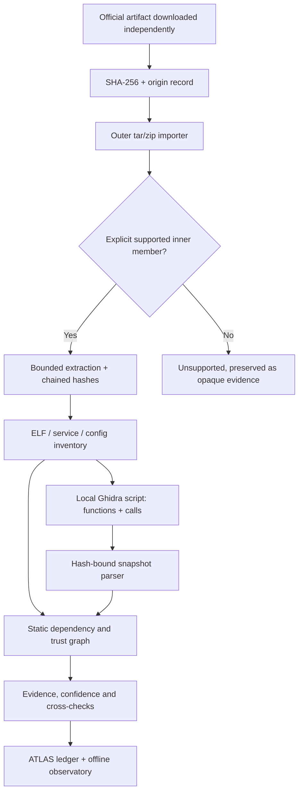

# BLACK GLASS | DSM research protocol and native evidence

Status: **DSM image acquired and found encrypted; native analysis demonstrated on
a licensed real-world ELF instead.** The official DSM binaries were not reached,
and that is reported honestly below rather than worked around.

This document separates facts established from public release listings and
source-code tests from observations that require a local firmware artifact.
It is not a report claiming to have run DSM, decompiled Synology binaries,
verified a publisher signature, or recovered security-sensitive routines.

## Acquisition result (2026-11-08)

The official image was downloaded independently and inspected:

| Field | Value |
|---|---|
| Artifact | `DSM_DS220+_72806.pat` (Synology DS220+, DSM 7.2.2 build 72806) |
| Source | `https://global.synologydownload.com/download/DSM/release/7.2.2/72806/DSM_DS220%2B_72806.pat` |
| Size | 387,262,777 bytes |
| SHA-256 | `1e74937c3a7adb517167a70b604b7ff3812d4a8a5abb4cd32838fe6e22222d2f` |
| `file(1)` | "Synology archive"; header magic `bf ad be ef` (the encrypted `.pat` format) |
| `tar -tf` | fails ("does not look like a tar archive") |
| Entropy | 8.000 bits/byte across head and middle windows; no plaintext container |

**Conclusion: the outer image is encrypted.** The scattered gzip/bzip2/zip byte
sequences are coincidental in high-entropy data, not structural members. Reaching
the DSM binaries would require circumventing the vendor's encryption, which is out
of scope (do not evade access controls or firmware security protections). No DSM
binary, symbol, service, trust anchor, update-verification routine, or behaviour is
asserted. This is an honest **NOT-EXAMINED** result for the DSM executables.

The firmware image is kept locally and is **never committed**.

## Native analysis demonstrated on a licensed ELF

Because the DSM userland could not be opened without defeating its encryption, the
genuine native-analysis and behavioural-reconstruction capability is demonstrated
on a **real-world, freely-licensed** binary of the same kind that firmware ships:
**BusyBox 1.35.0, x86-64, statically linked and stripped** (the canonical embedded
userland; GPL-2.0; public source for ground-truth validation). It is downloaded,
hashed, and analysed with Ghidra 12 headless; the DSM-specific run remains a
ready, documented step that this protocol will execute verbatim on any DSM
root-filesystem supplied already extracted. See
[`docs/BLACK_GLASS_NATIVE.md`](BLACK_GLASS_NATIVE.md) for the demonstration and the
Observed → Reconstructed → Implemented → Validated model.

## Identified artifact and acquisition

Research target: **Synology DS220+, DSM 7.2.2, build 72806**.

- Official archive index:
  https://archive.synology.com/download/Os/DSM/7.2.2-72806
- Entry in the official index: `DSM_DS220+_72806.pat`. The listing
  describes a roughly 369 MB image published on September 6, 2024.
- Official download:
  https://global.synologydownload.com/download/DSM/release/7.2.2/72806/DSM_DS220%2B_72806.pat
- Version-matched Synology GPL source catalogue:
  https://archive.synology.com/download/ToolChain/Synology%20NAS%20GPL%20Source/7.2-72806

**Provenance status:** the URLs and model/build pairing are confirmed by the
official catalogue. No firmware bytes were available in this development
environment. Consequently, no official-image SHA-256 digest, nested member
names, ELF architecture, imported symbols, service layout, trust anchors,
auth mechanisms, or update-verification behavior are asserted here.

Download the image independently on a host where you have the authority to
obtain and inspect it. Never commit proprietary firmware or extracted binary
payloads to this repository.

```sh
mkdir -p research/dsm-ds220-72806
cd research/dsm-ds220-72806
curl --fail --location --proto '=https' --tlsv1.2 \
  'https://global.synologydownload.com/download/DSM/release/7.2.2/72806/DSM_DS220%2B_72806.pat' \
  -o 'DSM_DS220+_72806.pat'
sha256sum 'DSM_DS220+_72806.pat' | tee acquisition.sha256
file 'DSM_DS220+_72806.pat' | tee container-type.txt
tar -tf 'DSM_DS220+_72806.pat' > archive-members.txt
```

The last command works **only if the downloaded PAT is a tar-compatible
container**. If it fails, record that result and use an independently
documented extractor under appropriate permissions. Do not treat a failed
extraction, encrypted payload, or guessed archive offset as a valid analysis.
A local SHA-256 is a byte identity, **not** independent publisher
authentication. For origin assurance, record the exact official URL, retrieval
date, HTTP metadata, and any separately verified publisher-signed digest
or genuine signature/trust anchor.

## Inspecting a supported, nested payload

Suppose `archive-members.txt` shows an inner `hda1.tgz` member (this is
**an example**, not a verified member of the identified DSM release):

```sh
uv run atlas firmware unpack 'DSM_DS220+_72806.pat' \
  --member hda1.tgz --out expanded
cat expanded/provenance.json
uv run atlas firmware inventory expanded/root --json > inventory.json
uv run atlas firmware analyze expanded/root \
  --root atlas-data/dsm-research --label DS220-plus-7.2.2-72806
uv run atlas ledger verify atlas-data/dsm-research/ledger
```

`unpack` requires an explicitly chosen, **regular-file tar/zip member**.
It uses the existing two-stage bounded importer; neither source archive nor
payload is executed. It rejects traversal, unknown formats, existing output
destinations, and extraction outside the source tree. Its
`provenance.json` binds outer archive digest, selected inner-member digest,
and the exact extracted tree-manifest digest. It **does not** attest that an
archive comes from Synology.

A raw compressed stream, encrypted PAT, cpio, squashfs, or proprietary block
layout remains unsupported by this command; report the condition honestly
and use a documented offline extractor only when licensed and authorised.
Inaccessible code must not be counted as a successfully examined executable.

## Optional function-level native analysis

The pure-Python static pipeline cannot recover a complete native call graph
from ELF headers. To add *actual disassembler-derived observations* without
running firmware or importing proprietary routines, use the included,
read-only Ghidra script. It inspects functions and call references in a local
Ghidra analysis database and emits **names, addresses, sizes, and edges only**,
not decompiled source.

```sh
# Run on your own workstation with Ghidra installed.
# Use the actual executable path within the extracted firmware tree.
GHIDRA_HOME=/path/to/ghidra
"$GHIDRA_HOME/support/analyzeHeadless" /tmp/bg-ghidra-project BG \
  -import /absolute/path/to/expanded/root/usr/sbin/example-binary \
  -scriptPath /absolute/path/to/rain-atlas/scripts \
  -postScript BlackglassCalls.py usr/sbin/example-binary \
    /absolute/path/to/expanded/root/usr/sbin/example-binary \
    /absolute/path/to/snapshots/example-binary.json \
  -deleteProject

uv run atlas firmware analyze expanded/root \
  --root atlas-data/dsm-with-native \
  --native-snapshot /absolute/path/to/snapshots/example-binary.json
```

The exporter requires `currentProgram.getExecutableSHA256()` to match the
**actual ELF bytes**. It refuses unsupported or oversized exports (currently
2,048 functions / 8,192 edges). The import path independently compares its
claimed executable SHA-256 with the binary inventoried from the firmware,
validates unique canonical addresses, and caps JSON input at 8 MiB.

The resulting graph gains `contains` and `calls` edges, with missing
targets represented as `unresolved-call`. It adds high-confidence **tool
observations** to the usual claims, challenges, verdicts and observatory.
Hash matching certifies attachment to the intended input **only**. No imported
call edge earns the `verified` label because there has been no independent
disassembly or runtime validation. This also means Ghidra's analysis settings
and function-recovery heuristics should be recorded separately.

### IDA-Ghidra-bridge

The third-party
[IDA-Ghidra-bridge](https://github.com/oscarsantanaarias/IDA-Ghidra-bridge)
is useful for **local exploratory work**. It exposes commands such as
`FUNC`, `CALLERS`, `XFROM`, `TRACE`, and `STRUCT` on loopback TCP.
It also exposes **mutating** commands including `PATCH`, so BLACK GLASS
does not start or automatically connect to the server. Keep the bridge
bound to `127.0.0.1`, never expose its port on a network, and use
read-only inspection commands manually. For immutable, ledger-bound call
graph import, use the Ghidra exporter above. The bridge's third-party code is
not bundled or copied.

## Scientific acceptance matrix

| Criterion | Evidence currently available | Still needed for DSM |
|---|---|---|
| Component inventory | Existing parser + controlled ELF tests | Whole-image file counts and independent cross-checks |
| Service and ELF dependencies | Existing static parser, baseline tests | DSM-specific init definitions and real rootfs |
| Native function graph | Ghidra exporter + hash-bound importer with adversarial tests | Actual Ghidra run on a selected DSM ELF; compare with a second disassembler |
| Network surface | Existing conservative static signature/config tests | ELF/config coverage audit; runtime observations are out of scope |
| Update authenticity | Operator-key detached signature verification | Genuine vendor public anchor and documented signature format |
| Version change detection | Existing synthetic v1/v2 comparison | Two acquired and independently hashed official releases |
| Negative controls | Truncated/malformed ELF, archive traversal, untrusted snapshot controls | Encrypted PAT, unavailable keys, unsupported layouts |
| Reproducibility | Stable deterministic JSON, existing ledger tests | Repeat full DSM extraction and analysis with fixed tool versions |

No metric from a synthetic fixture is a measured DSM accuracy. No actual DSM
native call graph, update-validation procedure, login authorization path,
or security boundary has been confirmed. Where observations are missing,
the scientific finding is **unverifiable**, not a hypothesis presented as a
fact.

## Architecture



## Non-transfer and licensing

The pipeline examines metadata and analysis-tool observations. It does not
copy firmware source, firmware images, binary routines, decompiled code, or
third-party tooling into the open-source project. The Synology GPL catalogue
is a **separate source corpus**; compare only what the relevant package licenses
permit, preserving attribution and source obligations. Any DSM security
mechanism not independently established from the bytes must remain an
open research question.
