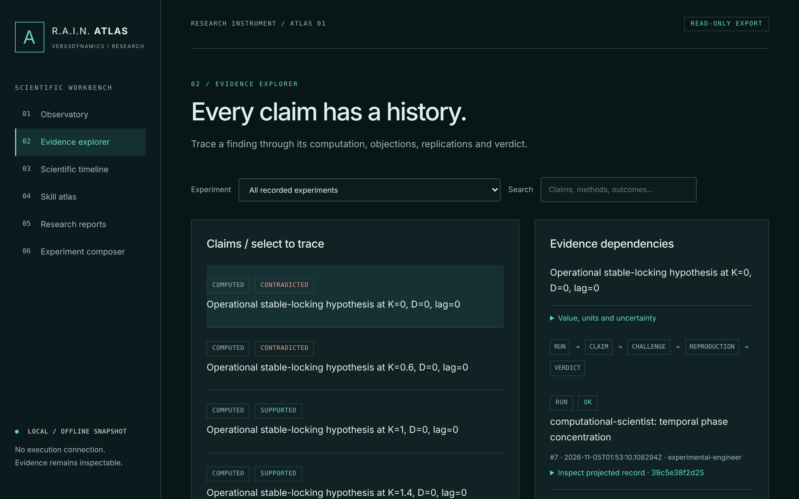

# Recorded synthetic demonstration

Open `index.html` locally to explore the recorded synchronization experiment.
It is an offline review projection with no execution connection. GitHub's source
view does not run it, so download the file first. `report.md` and `summary.json`
hold every condition, limitation and acceptance check. The PNG and SVG figures
come from the recorded run. `benchmark.json` is the spectral stress benchmark,
executed separately. `evidence-explorer.png` is a 2× Chromium screenshot of
`index.html`.



## Provenance (regenerated 2026-11-05 on Linux)

- Engine commit `a2ac9f6eeb42eaeb392280aca4884a3d590bd85c`, clean tree. The
  same commit is recorded in every run.
- Engine source-tree hash:
  `sha256:6d934023aba354191646bbed9fcc669e263d7965828663f566887eb0a4b44fef`.
- Linux 6.18 x86-64, glibc 2.39, CPython 3.12.3, NumPy 2.5.4, SciPy 1.18.1,
  Matplotlib 3.11.2, all from the committed lockfile.
- Synchronization ledger: all 140 records and their referenced artifacts
  verified. Benchmark ledger: 4 records verified. Seed 20261104, 12 trials per
  case.

```sh
uv run atlas experiment run synchronization --root atlas-data/reproduce-sync --replicates 12
uv run atlas benchmark --root atlas-data/reproduce-benchmark --trials 12
```

**Why it was regenerated.** None of the 22 skill content hashes in the earlier
Windows-recorded copy could be reproduced from a clean checkout on any operating
system. Path ordering was OS-dependent, and the generated skills were hashed with
CRLF bytes that git never committed. This copy's hashes match a clean checkout
for all 22 skills. The earlier copy's Reports view also overflowed the page.

**Cross-platform agreement with the Windows run** (x64 CPython 3.12.15 on ARM64):

| Artifact | Agreement |
|---|---|
| Verdicts | Identical for all 30 conditions: 5 supported, 10 unresolved, 15 contradicted |
| `report.md` and the SVG figure | Byte-identical |
| PNG figure | Pixel-identical (all 2,073,600 pixels); only the compressed bytes differ |
| Benchmark | Identical rate counts and per-trial detection counts in all 12 method × case cells |

These files are derived review artifacts, not the full ledger or an external
authentication. Original runs and source snapshots remain in the local ledger.
See [../VALIDATION.md](../VALIDATION.md) for commands, environments, sample
sizes, negative results and unexecuted checks.
